# Лабораторная 1 — Свой Docker

Исследовал контейнер как обычный Linux-процесс с отдельными namespaces, ограничениями cgroups v2 и урезанными правами. Основные эксперименты выполнял в Ubuntu под WSL2 с Docker Desktop. Исправленный скрипт, образы, gVisor и мониторинг повторно проверил 1 ноября 2026 года на Linux с обычным Docker Engine. Для нагрузки использовал собственный HTTP-сервис на Go.

## Сервис и исходный запуск

В [api/main.go](api/main.go) реализованы три эндпоинта: `/health` возвращает `ok`, `/eat?mb=N` выделяет и удерживает N МиБ памяти, `/burn` запускает бесконечную CPU-нагрузку в отдельной goroutine. При выделении памяти сервис касается страниц, чтобы эксперимент проверял фактическое потребление, а не только резервирование адресного пространства. Повторный `/eat` добавляет память к уже удерживаемой, повторный `/burn` добавляет ещё одну нагрузку.

Запустил API напрямую и проверил `http://127.0.0.1:8080/health`: HTTP 200, тело `ok`; открыл этот же адрес в Firefox и увидел `ok`. При повторной проверке `ps -p "$PID" -o pid,uid,comm` показал PID 1035801, UID 1000, команду `api`. Процесс наследует окружение пользователя: отдельные namespaces и ограничения моего рантайма появляются только при запуске через `mydocker.sh`.

## Namespaces

В [mydocker.sh](mydocker.sh) создаются шесть пространств имён:

| Namespace | Что изолирует и как используется |
| --- | --- |
| PID | Нумерацию и видимость процессов. После цепочки `exec` API занимает PID 1. |
| Mount | Таблицу монтирований. `--mount-proc` даёт `/proc` нового PID namespace. Сам по себе mount namespace не меняет корень файловой системы. |
| Network | Интерфейсы, маршруты, порты и сетевой стек. Скрипт поднимает только loopback; veth и внешней сети нет. |
| UTS | Имя хоста, которое скрипт меняет на `mycontainer`. |
| IPC | Объекты System V IPC и POSIX message queues. |
| User | Отображение UID/GID: `--map-root-user` отображает запускающего пользователя в root нового user namespace. |

На снимке проверки `NSpid: 6801 1`: один процесс имеет PID 6801 снаружи и PID 1 внутри. Он находится в `/mydocker`; лимиты составляют 64 МиБ RAM, ноль swap, половину ядра и 32 задачи. Это ранний запуск: `CAP_NET_RAW` ещё присутствует в bounding set.

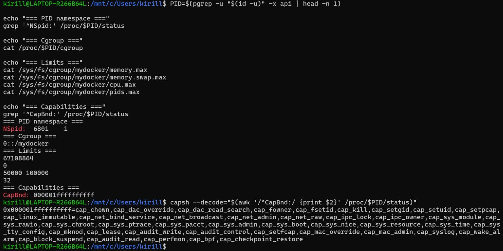

Повторно вошёл через `nsenter` в user, mount, PID, network и UTS namespaces своего API. Получил:

```text
Хост: PID 1035484, UID 1000, api
uid_map: 0 1000 1
NSpid: 1035484 1
Внутри ps: 1 api, 7 sh, 8 ps
hostname: mycontainer
ip -br addr: lo UNKNOWN 127.0.0.1/8 ::1/128
/health: ok
```

В списке видны API и команды самой проверки, а хостовые процессы скрыты. У сети только loopback, внешних интерфейсов и маршрута наружу нет. Mount namespace отделяет таблицу монтирований; корень остаётся хостовым, поэтому файлы доступны в пределах прав пользователя. User namespace меняет отображение UID, а не превращает UID 1000 в администратора хоста.

## Ограничения ресурсов

### Память

Создал cgroup v2 с `memory.max=67108864` (64 МиБ) и `memory.swap.max=0`. В исправленном скрипте стартовая оболочка входит в группу до `unshare` и запуска API: потомки наследуют группу, и стартовые выделения памяти учитываются в ней сразу.

Запрос `/eat?mb=100` превысил лимит. Curl получил `Empty reply from server`, API завершился, а в `memory.events` сохранился результат:

```text
max 58
oom 1
oom_kill 1
oom_group_kill 0
```

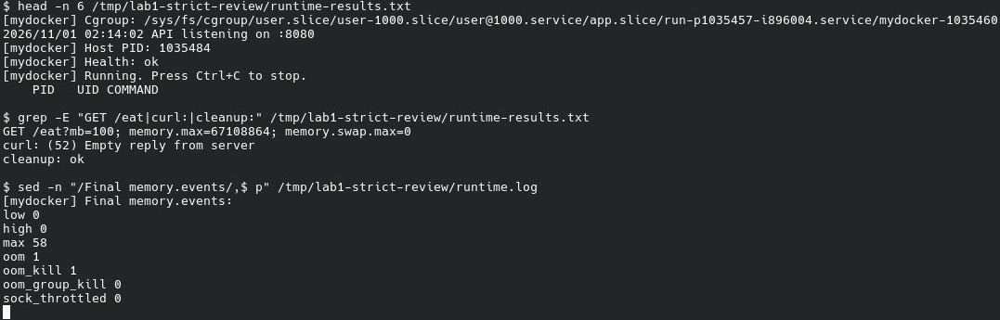

Именно рост `oom_kill` подтверждает убийство процесса ядром; обрыв HTTP сам по себе этого не доказывает. В первом опыте часть памяти уходила в swap, поэтому отдельно запретил его. `memory.max` и `memory.swap.max` контролируют разные бюджеты. В Kubernetes такое завершение контейнера отражается как `OOMKilled`.

### CPU

Установил `cpu.max = 50000 100000`: cgroup получает 50 мс CPU-времени на период 100 мс. Это суммарная квота группы, а не закрепление за половиной конкретного ядра.

После `/burn` в `cpu.stat` видны `nr_periods=3488`, `nr_throttled=3485`, `throttled_usec=148356931`. Нагрузка регулярно исчерпывает квоту и ждёт следующего периода. В отличие от OOM, throttling не завершает процесс. Значение `%CPU` из `ps` усреднено за жизнь процесса, поэтому не обязано точно равняться 50%.

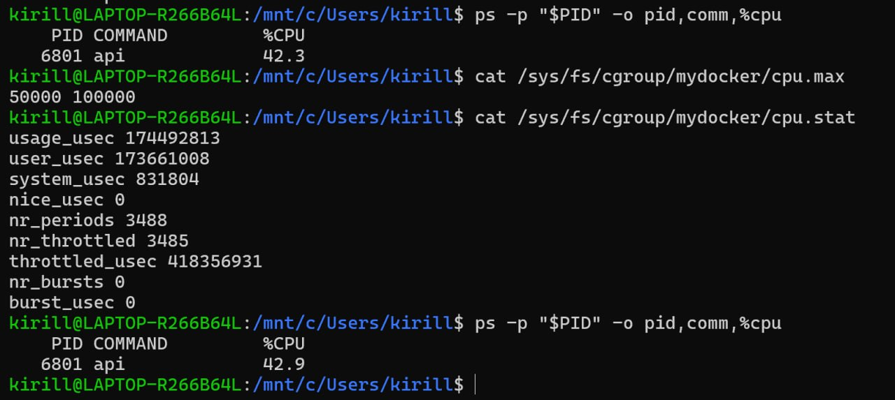

### Количество задач

Запустил `stress-ng --fork 64 --timeout 10s` из оболочки, заранее помещённой в cgroup. Потомки наследуют её принадлежность. При `pids.max=32` счётчик `pids.events max` достиг 35071, после нагрузки `pids.current=10`. Это число отказов создания задач, а не количество одновременно живущих процессов. PIDs controller учитывает также потоки, что существенно для Go runtime.

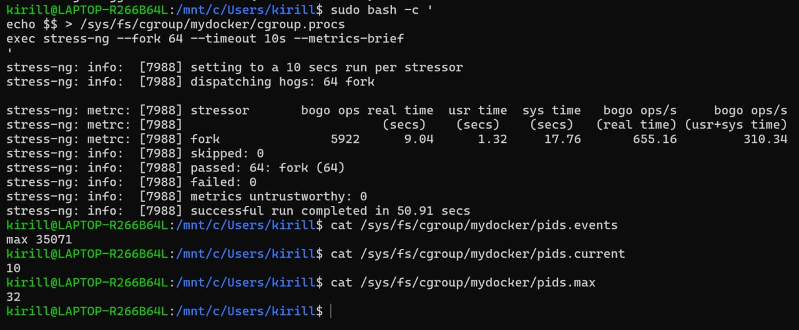

## Capabilities и seccomp

В отдельном user/network namespace Python сначала успешно создал raw ICMP socket. После `setpriv --bounding-set=-net_raw` такая же операция завершилась `PermissionError: Operation not permitted`.

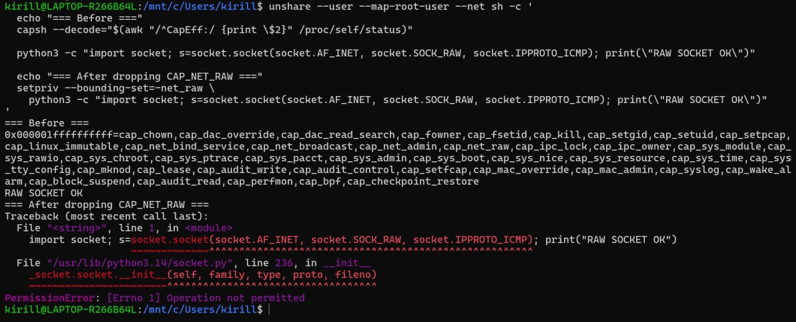

После настройки hostname и loopback итоговый скрипт выполняет `setpriv --bounding-set=-all --no-new-privs`: сервису на порту 8080 capabilities не требуются. Повторная проверка `/proc/PID/status` показала `CapPrm=0`, `CapEff=0`, `CapBnd=0`, `NoNewPrivs=1`; `/health` продолжил отвечать `ok`. Сброс bounding set ограничивает восстановление capabilities при exec, а `no_new_privs` запрещает приобретать новые привилегии через исполняемые файлы.

Для seccomp подготовил две разные программы. [seccomp_demo.c](seccomp/seccomp_demo.c) разрешает все системные вызовы, кроме `getpid`, и возвращает для него `EPERM`. До фильтра вызов возвращал 49605, после — `-1` с `errno=1`.

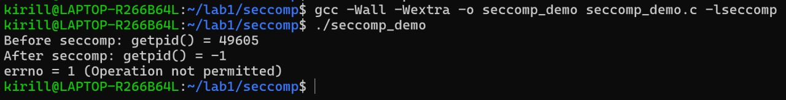

[seccomp_exec.c](seccomp/seccomp_exec.c) используется в рантайме: запрещает `ptrace` и запускает переданную команду через `execvp`. Фильтр наследуется при exec. Правила профиля заданы в C-коде. Для проверки именно этой обёртки запустил маленькую программу с `ptrace(PTRACE_TRACEME)`: напрямую она вернула `0, errno=0`, через `seccomp_exec` — `-1, errno=1`. Здесь seccomp избирательно запрещает syscall; API продолжает работать с установленным фильтром.

Capabilities проверяют право выполнить привилегированную операцию, seccomp фильтрует системные вызовы. Namespaces задают область видимости ресурсов, cgroups — их бюджет. Эти механизмы дополняют друг друга.

## Собственный рантайм и Docker

Скрипт [mydocker.sh](mydocker.sh) настраивает cgroup, запускает API через `unshare`, `setpriv` и seccomp-обёртку, затем проверяет `/health` через вход в сетевой namespace.

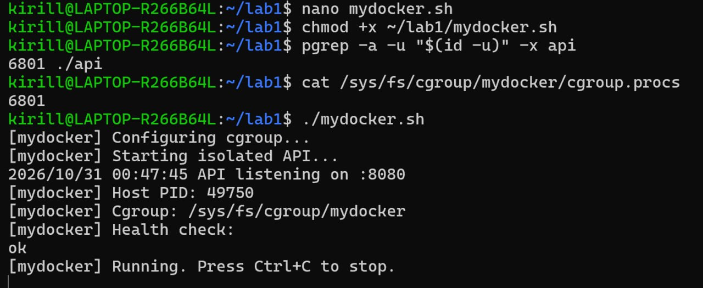

На снимке первого варианта процесс 50740 виден внутри как PID 1, находится в `/mydocker`, имеет `NoNewPrivs: 1`, `Seccomp: 2` и bounding set без `CAP_NET_RAW`. В окончательном варианте capabilities сброшены целиком: нулевые наборы и HTTP проверены отдельно, как описано выше.

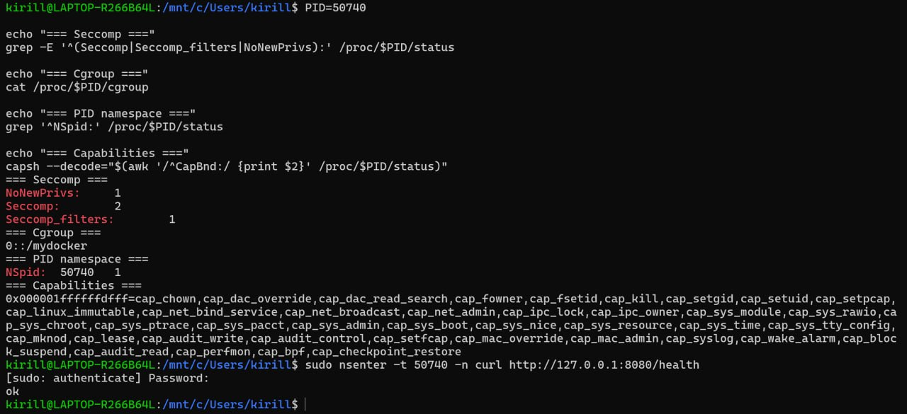

Тот же API запустил из `myapi:multi` через Docker с публикацией порта `8081:8080`: запрос вернул `ok`, контейнер находился в состоянии `Up`.

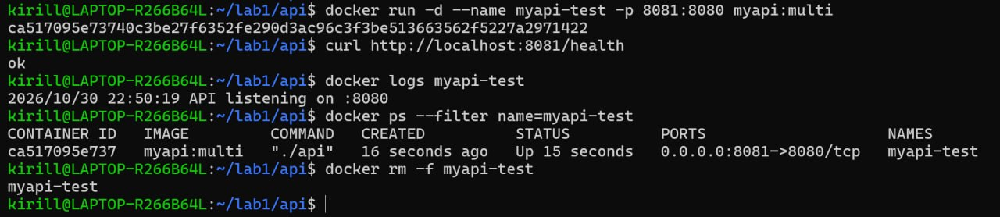

| Механизм | mydocker.sh | Docker в проведённом опыте |
| --- | --- | --- |
| Процесс и namespaces | API — обычный процесс; создаются шесть namespaces | Обычный процесс в namespaces; user mapping зависит от конфигурации Docker |
| Ресурсы | 64 МиБ, без swap, 0,5 CPU, 32 задачи | Лимиты задаются параметрами запуска; в мониторинговом опыте — 128 МиБ, 1 CPU, 64 задачи |
| Права | Все capabilities сброшены после настройки, seccomp запрещает ptrace | Docker задаёт стандартный набор capabilities и seccomp, их можно менять флагами запуска |
| Файловая система | Хостовый корень, отдельная таблица монтирований | Корень из образа, отдельный writable layer, подключаемые volumes |
| Сеть | Только loopback, проверка через nsenter | Настроена публикация порта на хосте |
| Жизненный цикл | Собственный launcher, ожидание готовности, trap, остановка потомков и удаление cgroup | Engine управляет созданием, запуском, остановкой и удалением контейнера, логами и метаданными |

Пути вычисляются относительно самого скрипта. Каждый запуск создаёт отдельную cgroup, а PID берётся из потомков конкретного `unshare`. Проверка готовности ждёт HTTP 200 и тело `ok`. При ошибке или сигнале `trap` останавливает собственные процессы, печатает `memory.events` и удаляет группу.

Дополнительно проверил запуск рядом с уже работающим `api`: прямой процесс имел PID 1035801, изолированный — 1035829. После SIGTERM скрипт завершился с кодом 143, его cgroup была удалена, а прямой API продолжил отвечать `ok`. Это проверяет, что поиск и cleanup относятся к своему запуску.

Для повторного прогона cgroups использовал временный user-service systemd с `Delegate=yes` и `DelegateSubgroup=control`: это выдаёт пользователю собственную ветку cgroup v2. В ней включил CPU, memory и pids и передал путь через `CGROUP_PARENT`. Обычный запуск использует sudo только для настройки и обслуживания cgroup; API остаётся процессом обычного пользователя.

## Образы, кэш и данные

Подготовил [обычный Dockerfile](api/Dockerfile.simple) на `golang:1.26` и [multi-stage Dockerfile](api/Dockerfile): сборка с `CGO_ENABLED=0`, затем перенос бинарника в `alpine:3.22`.

| Образ | Размер на снимке | Содержимое итогового окружения |
| --- | --- | --- |
| myapi:simple | 969 MB | Go toolchain, исходники и бинарник |
| myapi:multi | 16,7 MB | Alpine и готовый бинарник |

Итоговый размер уменьшился примерно в 58 раз, на 98,3%. Слои builder не входят в финальный образ. Для runtime выбрал Alpine: он мал и позволяет тем же образом проверить файлы и выполнить HTTP-пробу внутри gVisor через shell и wget.

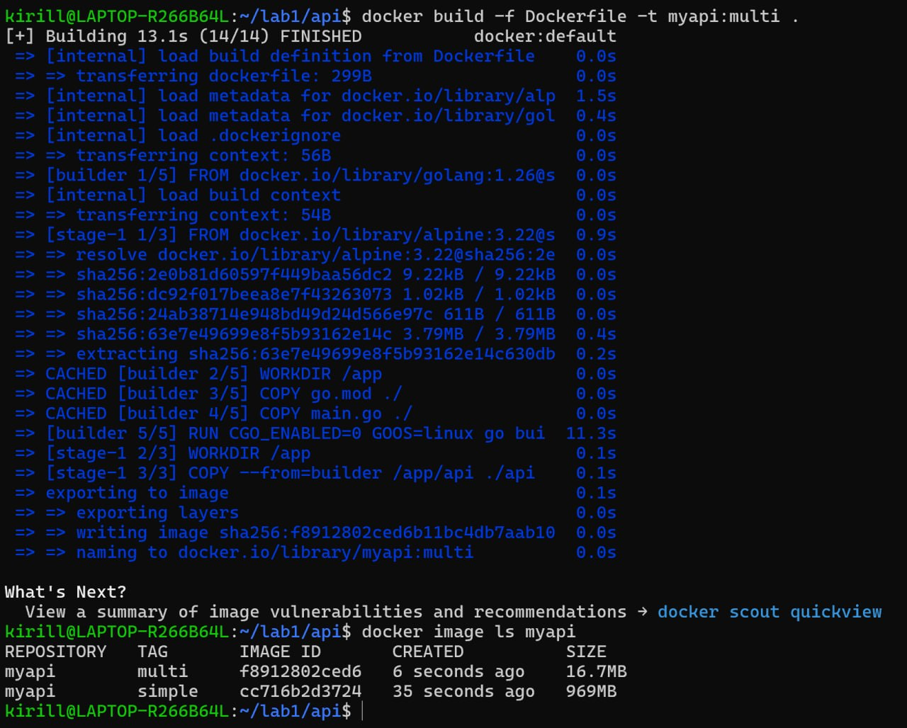

В опыте с кэшем добавил комментарий в `main.go` и повторил сборку классическим builder. `WORKDIR` и `COPY go.mod` использовали кэш, `COPY main.go` и компиляция выполнились заново. После опыта комментарий удалил. Число шагов сборки не равно числу файловых слоёв: `CMD` и `EXPOSE` меняют конфигурацию образа. Повторная проверка `docker image inspect --format '{{.Size}} {{len .RootFS.Layers}}'` дала:

| Образ | Размер, байт | Файловых слоёв |
| --- | ---: | ---: |
| myapi:simple | 968974812 | 11 |
| myapi:multi | 16667481 | 3 |

При повторной сборке без изменения файлов все шаги использовали кэш, включая компиляцию и копирование из builder.

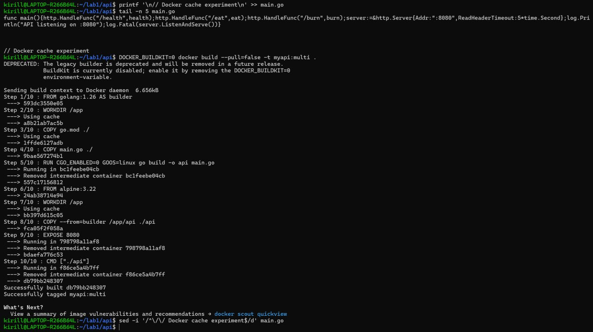

Для проверки volume использовал отдельный [образ на Alpine](volume-test/Dockerfile). Временный контейнер записал `Hello from Docker volume!` в `/data/test.txt` на именованном томе `lab1-data`; новый контейнер с тем же томом прочитал строку.

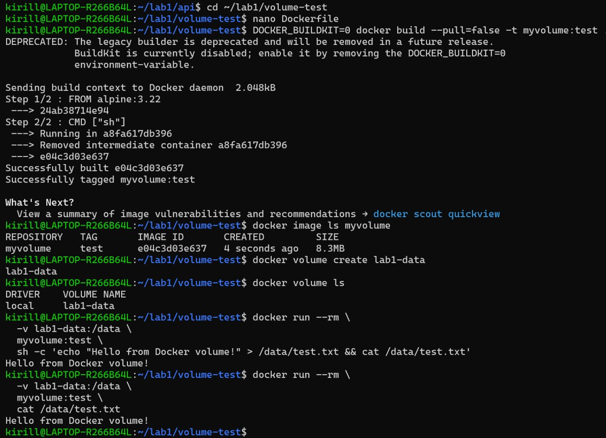

Парный опыт повторил на `myapi:multi`. Первый контейнер записал `transient` в `/tmp/lab1-file` и был удалён; следующий контейнер из того же образа подтвердил отсутствие файла (`writable-layer-file-gone`). Затем первый контейнер записал `persistent` в `/data/lab1-file` на именованном томе, и новый контейнер с тем же томом прочитал `persistent`.

Writable layer принадлежит конкретному контейнеру: stop/start сохраняет его, удаление контейнера удаляет. Volume имеет отдельный жизненный цикл; удаление подключавшего его контейнера оставляет данные на месте.

## gVisor и граница изоляции

В WSL2 запускал `runsc` с платформой `systrap` и `--network=none`. На сохранённом снимке выполнено `sudo runsc --platform=systrap --network=none do /home/kirill/lab1/api/api`, после чего API вывел `API listening on :8080`.

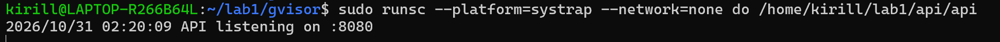

Для запуска образа использовал [gvisor/test-api.sh](gvisor/test-api.sh). Скрипт экспортирует файловую систему `myapi:multi`, создаёт OCI bundle и запускает `runsc` от обычного пользователя с отображением одного UID/GID. Внутри bundle стартует `/app/api`, а wget ждёт готовности `/health` через loopback. После опыта временный контейнер и bundle удаляются.

Сравнил `uname -a`: под `runsc do` он возвращает `4.4.0`, в обычном Docker — `6.18.54.1-microsoft-standard-WSL2`. Это различие представления системной информации, а не измерение прочности изоляции и не наличие отдельного Linux-ядра версии 4.4.

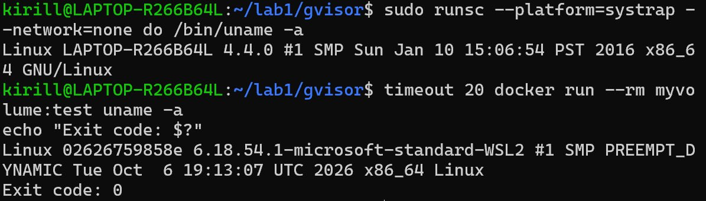

Обычный контейнер и мой скрипт используют ядро соответствующего Linux-хоста: системные вызовы приложения обрабатывает общее ядро. В Docker Desktop этим хостом служит Linux-окружение Engine, а не ядро Windows. Namespaces и cgroups не создают отдельного ядра, поэтому уязвимость доступного интерфейса ядра остаётся пределом такой изоляции.

gVisor добавляет Sentry — реализацию значительной части Linux ABI в userspace. Она обрабатывает вызовы приложения и использует более узкий интерфейс ядра хоста. Это уменьшает прямую поверхность атаки на ядро ценой совместимости и накладных расходов; само ядро хоста по-прежнему участвует в выполнении песочницы.

Повторный запуск образа с `runsc release-20261026.0` вернул:

```text
ok
Linux runsc 4.19.0-gvisor #1 SMP Sun Jan 10 15:06:54 PST 2016 x86_64 Linux
```

Выбрал OCI bundle, чтобы запускать образ без изменения настроек Docker daemon. Сеть песочницы — `none`, проба идёт изнутри по loopback; `--ignore-cgroups` отделяет этот опыт с устройством изоляции от проверки лимитов в предыдущих частях. В обычном Docker и моём скрипте приложение обращается к Linux-ядру хоста; под gVisor — к Sentry. Отдельный rootfs появился из того же образа, что использовал Docker.

При установке текущего gVisor понадобился полный архив с `gvisor-bin/`, а не одиночный бинарник runsc. Сверил SHA-512 архива перед запуском. Основа настройки — официальные инструкции [установки](https://gvisor.dev/docs/user_guide/install/) и [rootless OCI](https://gvisor.dev/docs/user_guide/rootless/).

## Мониторинг и три алерта

Запустил `lab1-api` с `--memory=128m --cpus=1 --pids-limit=64 -p 8081:8080`. Проверка `/health` вернула `ok`.

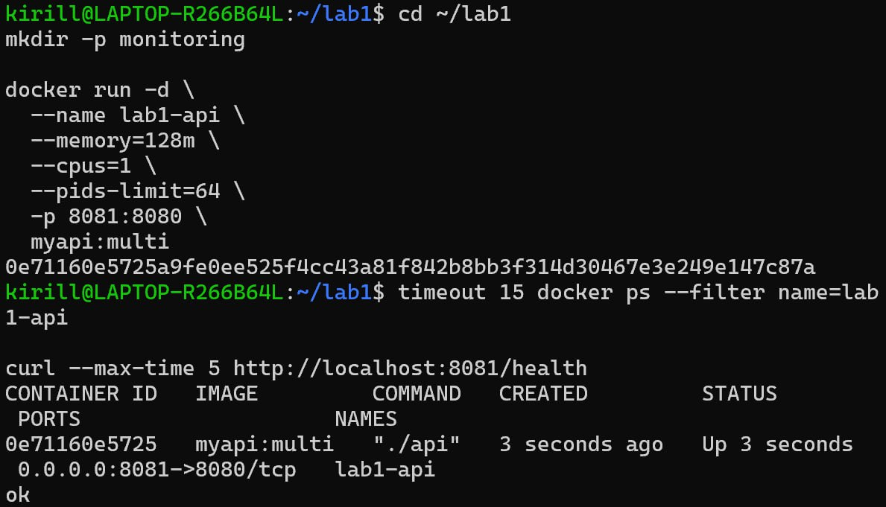

cAdvisor не дал ожидаемой выборки по имени контейнера, поэтому использовал [Python-экспортёр](monitoring/exporter.py), который получает статистику из Docker API через Unix socket и отдаёт её на порту 9108. Экспортируются состояние контейнера, память и её лимит, накопленное CPU-время, квота CPU, число задач, количество CPU-периодов, ограниченных периодов и время throttling. Наносекунды из Docker API преобразуются в секунды.

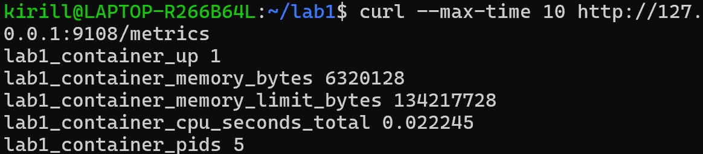

Prometheus собирает их каждые 5 секунд по [prometheus.yml](monitoring/prometheus.yml); цель `host.docker.internal:9108` находится в состоянии `UP`. Для доступа из контейнера экспортёр слушает `0.0.0.0:9108`; на Linux Engine имя хоста добавляется через `--add-host host.docker.internal:host-gateway`. Ошибка Docker API или stats даёт HTTP 503 и `up=0` у Prometheus, остановка либо отсутствие контейнера — `lab1_container_up=0`. Эти состояния можно различить при диагностике.

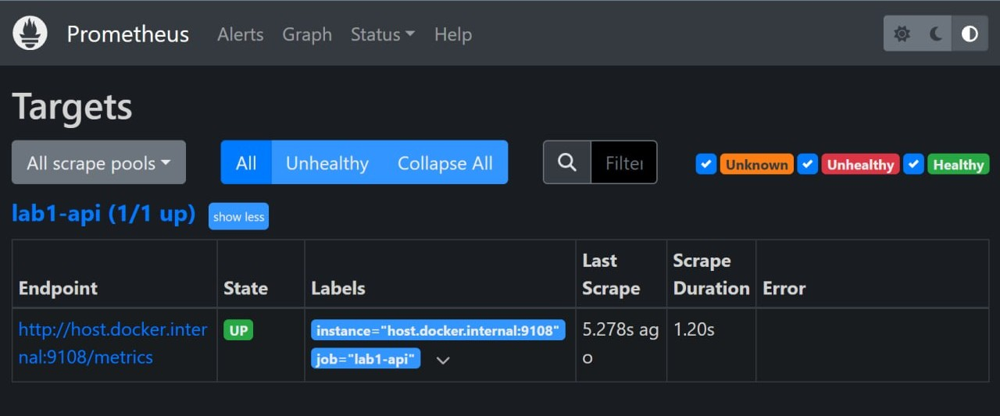

В Grafana собрал дашборд с памятью, CPU и числом задач. Сохранённый снимок показывает штатный простой. Для CPU накопленное время нужно преобразовывать через `rate`: секунды CPU в секунду дают число занятых ядер; умножение на 100 даёт процент одного ядра. При лимите 1 CPU это совпадает с процентом квоты, при другой квоте нужна нормализация. Дашборд сохранён в [monitoring/dashboard.json](monitoring/dashboard.json), три правила — в [monitoring/alerts.yml](monitoring/alerts.yml). Для воспроизведения правила вычисляет Prometheus каждые 5 секунд, длительность превышения порога — 15 секунд. В JSON добавлены панели доли ограниченных CPU-периодов и скорости накопления throttled time.

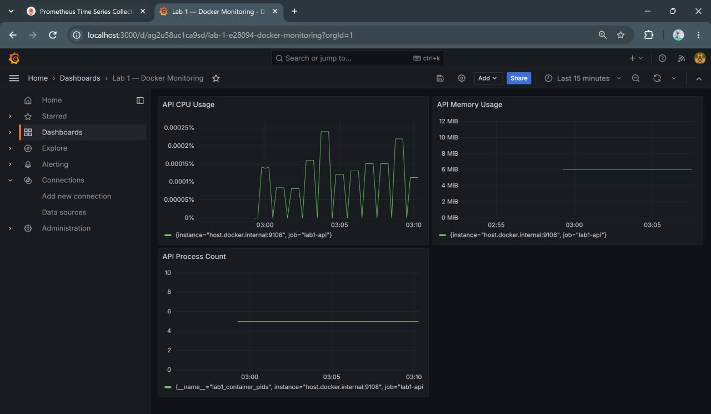

| Правило | Описанное условие | Что обнаруживает и чем грозит |
| --- | --- | --- |
| Lab1 High Memory | Использование больше 80% лимита памяти | Сокращение запаса до OOM и риск завершения API с потерей незавершённых запросов |
| Lab1 High CPU | `rate(lab1_container_cpu_seconds_total[30s]) / lab1_container_cpu_limit_cores > 0.8` | Насыщение CPU и риск роста задержек; само по себе не доказывает throttling |
| Lab1 Container Down | `lab1_container_up == 0` или scrape недоступен | Остановку контейнера или потерю наблюдения; грозит незамеченной недоступностью API, причину различаю по `up` |

В правилах памяти и CPU добавил условие работающего контейнера, чтобы при остановке срабатывало правило недоступности. `lab1_container_up` показывает `State.Running`; HTTP отдельно проверяю через `/health`. При ошибке scrape алерт недоступности также срабатывает, а отсутствие ряда само по себе не заменяется фиктивным нулевым потреблением.

Для проверки остановил контейнер: Docker показал `Exited (2)`, экспортёр вернул `lab1_container_up 0`. Код 2 сам по себе не указывает на OOM.

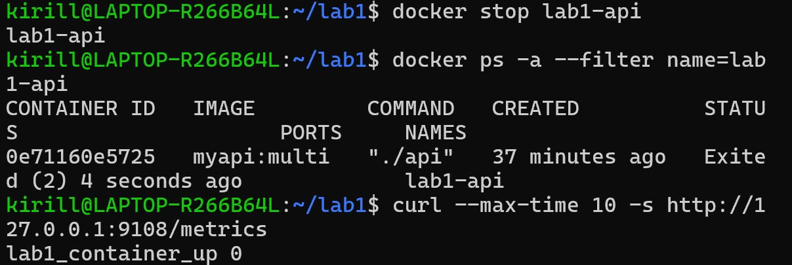

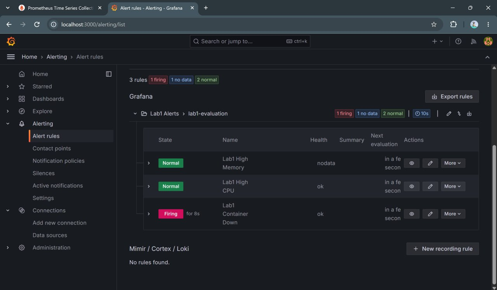

После запуска контейнера отдельная HTTP-проверка вернула `200 OK` и `ok`. Мгновенная готовность после `docker start` не гарантируется.

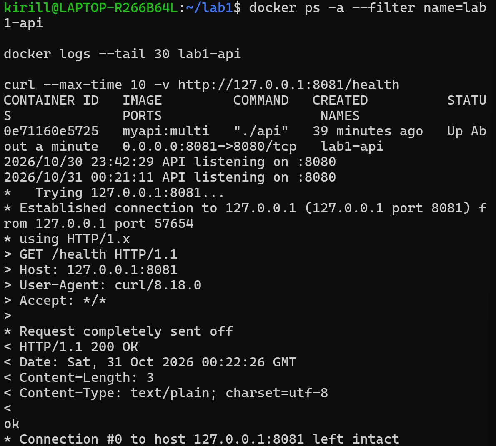

Для проверки CPU вызвал `/burn`: `docker stats` показал 99,87% одного ядра, правило `Lab1 High CPU` перешло в `Firing`.

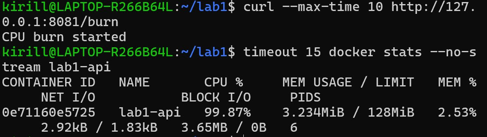

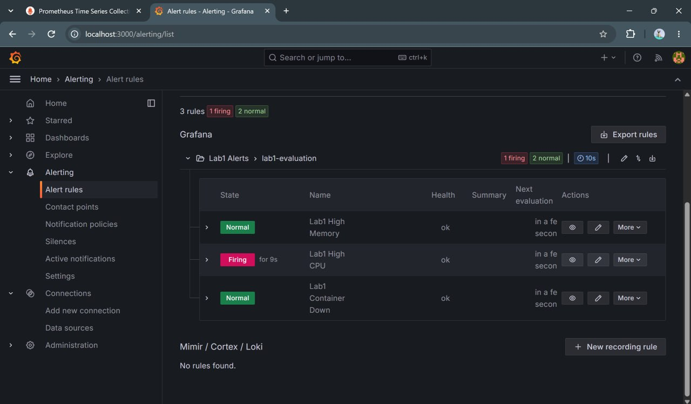

Для проверки памяти выделил сначала 95 МиБ, затем ещё 6 МиБ. `docker stats` показал рост с 98,05 МиБ (76,61%) до 103,7 МиБ (81,04%) из 128 МиБ; правило памяти перешло в `Firing`. Значение памяти из Docker API может отличаться от показателя CLI из-за учёта кэша: на снимке экспортёр выдаёт немного большую величину.

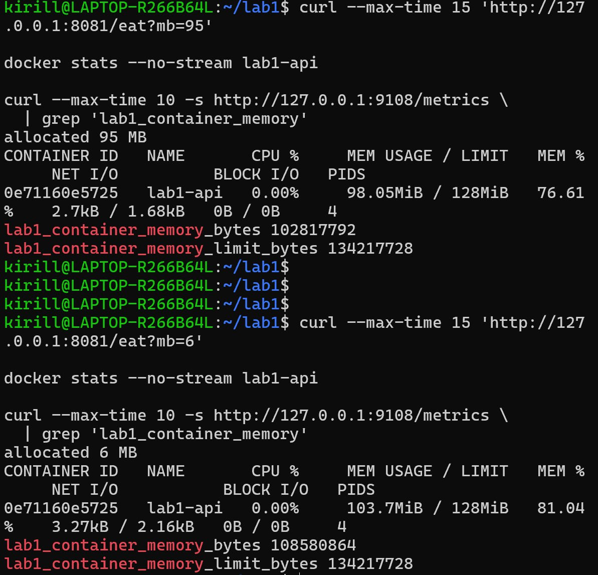

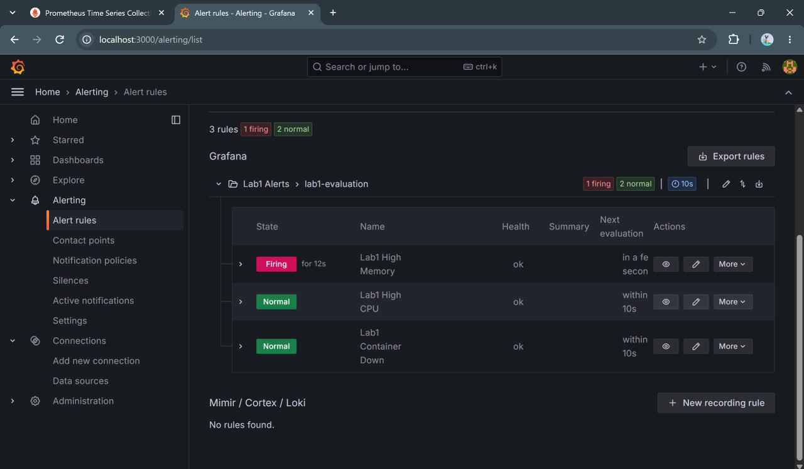

После перезапуска API память снизилась до 2,492 МиБ, CPU — до 0,00%, `/health` снова ответил `ok`; все три правила вернулись в `Normal`.

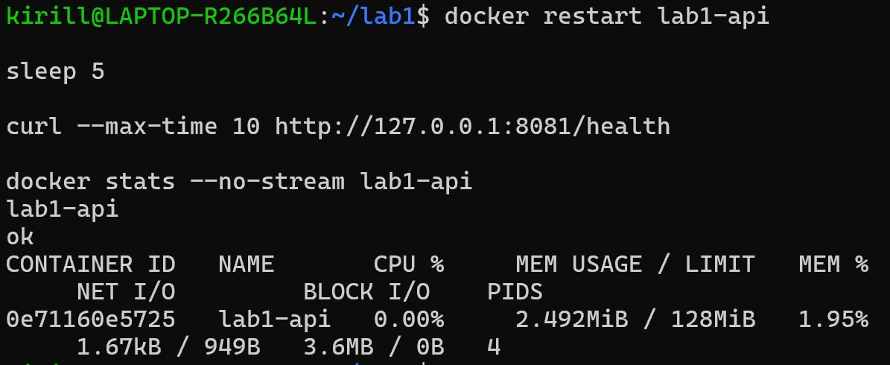

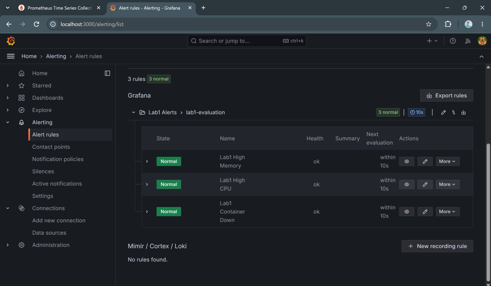

Повторно загрузил сохранённый JSON в Grafana и подключил Prometheus. `promtool check config` подтвердил конфигурацию и все три правила. Под `/burn` и `/eat?mb=100` правила CPU и памяти перешли в `firing`; измеренная загрузка составила 0,9966 ядра, `cpu_throttled_periods_total=43`, `cpu_throttled_seconds_total=0,032641`. После остановки контейнера сработал `Lab1ContainerDown`, после запуска список активных алертов опустел.

Throttling смотрю по `100 * rate(lab1_container_cpu_throttled_periods_total[30s]) / rate(lab1_container_cpu_periods_total[30s])`. Это доля периодов с исчерпанной квотой, а не процент CPU; время ожидания отдельно показывает `rate(lab1_container_cpu_throttled_seconds_total[30s])`. Именно сочетание загрузки и throttling помогает отличить расход CPU от ожидания своей квоты.
