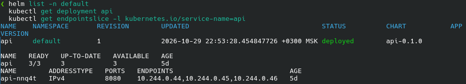
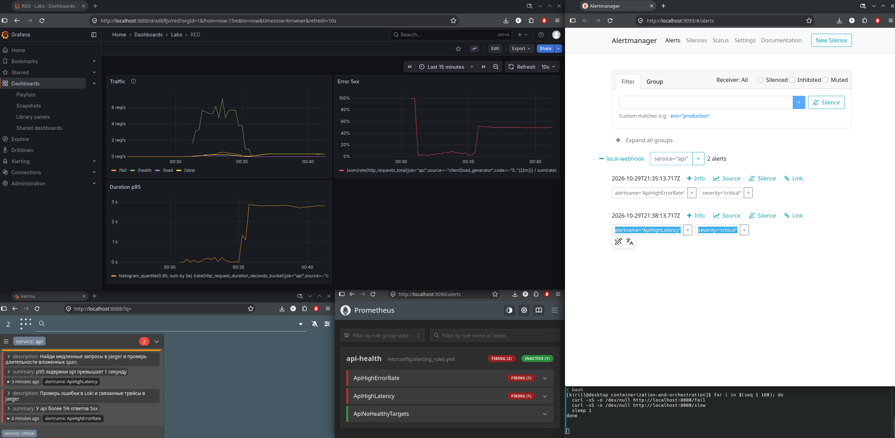
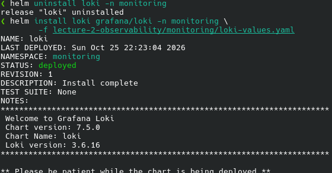
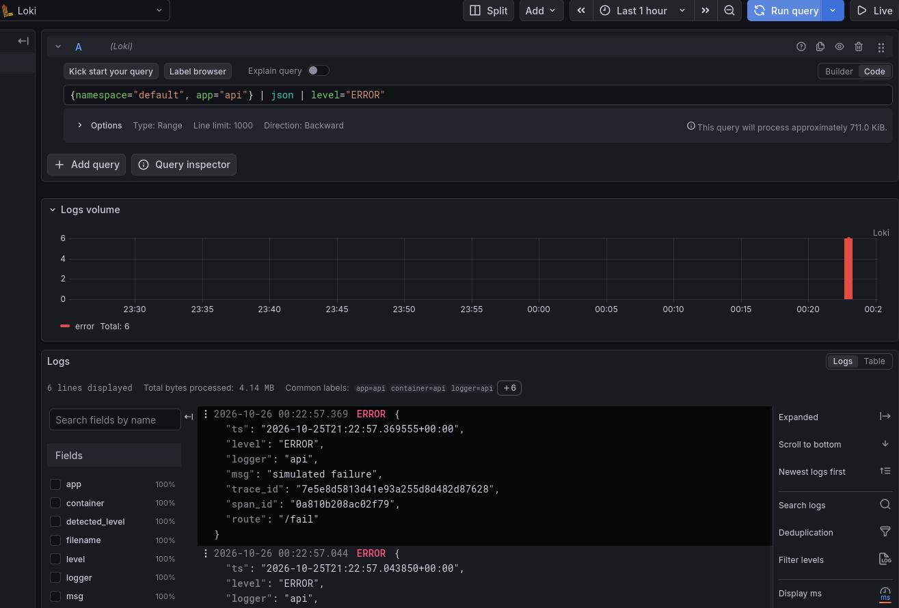
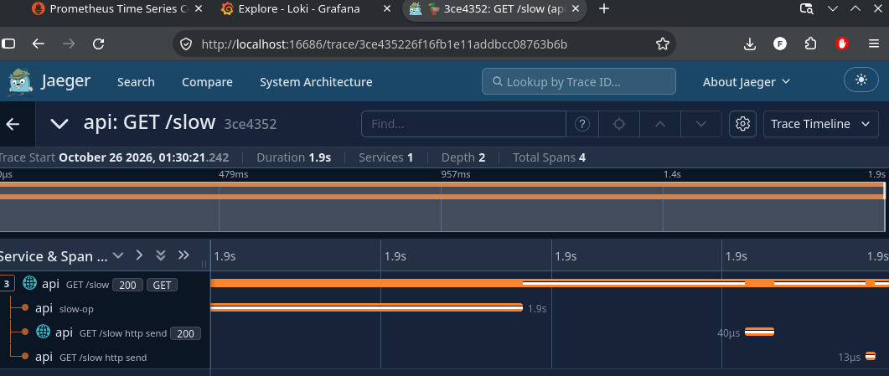
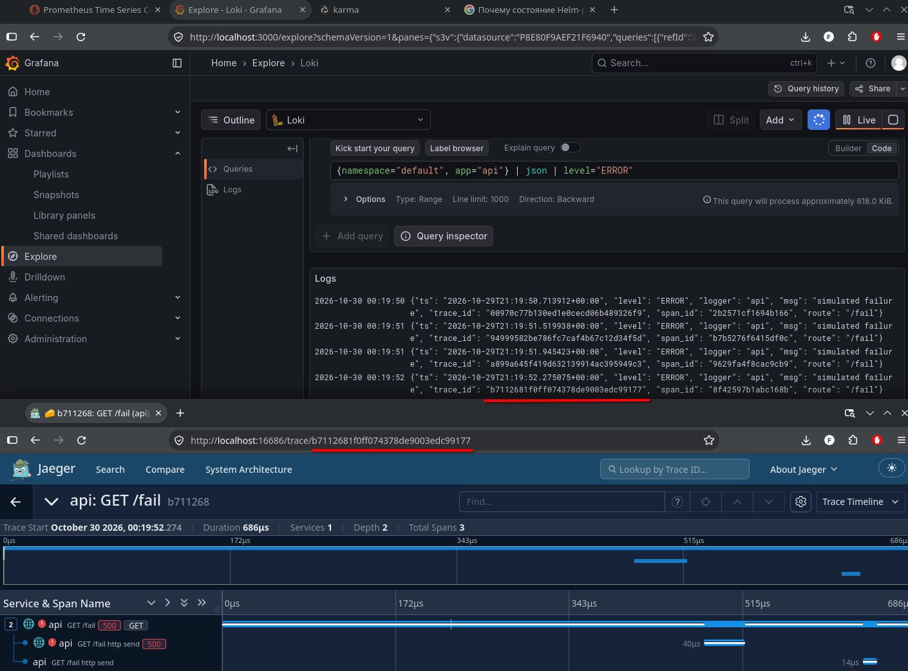
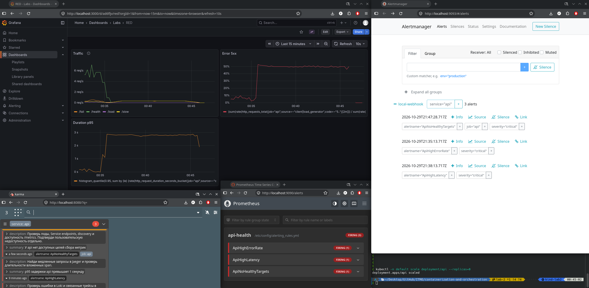
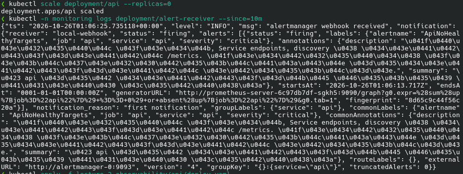
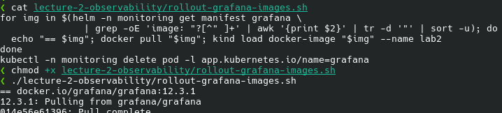
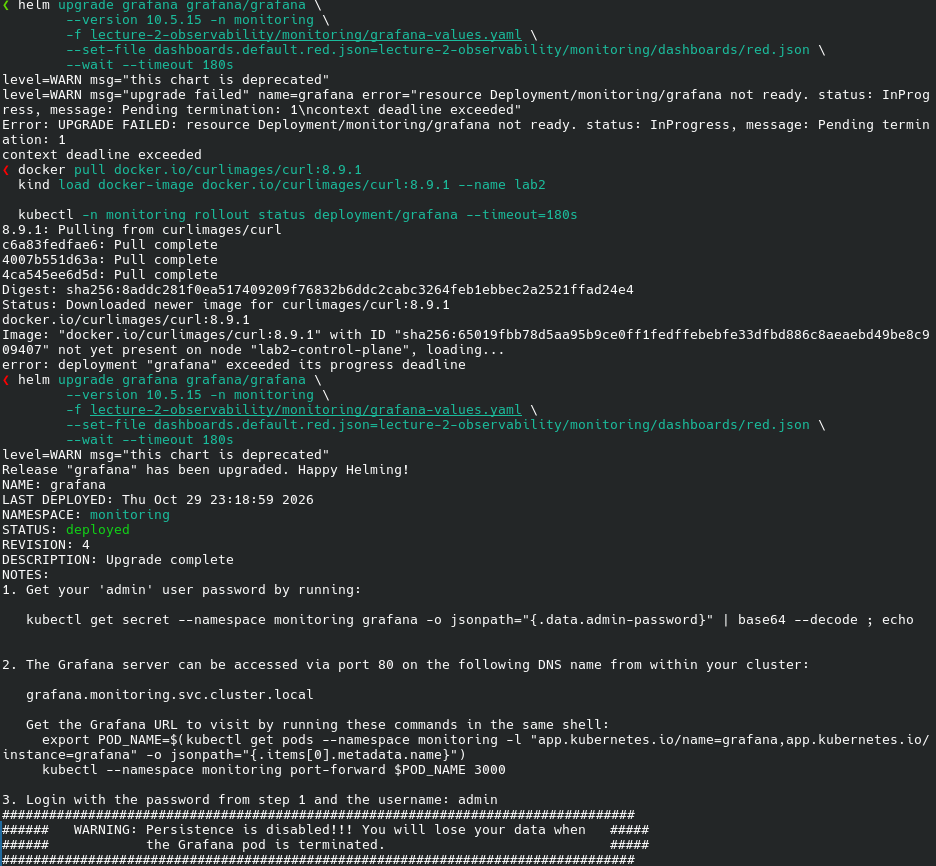

# Лабораторная 2 — Мониторинг сервиса

Развернул стенд в локальном kind-кластере `lab2`. Приложение `api` работает в namespace `default`, остальные компоненты — в `monitoring`. Весь итоговый стенд управляется через Helm. Для доступа к интерфейсам использовал `kubectl port-forward`.

Для экспериментов сгенерировал сервис на FastAPI:

- `/health` возвращает `ok`,
- `/fail` — 500,
- `/slow` задерживает ответ на 1–3 секунды,
- `/load` делает пачку запросов к собственному `/health`.

Добавлены метрики на `/metrics`, JSON-логи в stdout и OpenTelemetry-инструментацию. Для `/slow` выделен вложенный span `slow-op`, для `/fail` — запись исключения и статус ошибки.

Сначала запустил api через обычный манифест, затем перенёс его под управление собственного Helm chart. В итоге приложение работает в трёх репликах. Состояние release и Deployment видно на [скриншоте](screenshots/9.3-api-in-helm.png).



## Метрики и дашборд

Установил Prometheus, настроил обнаружение endpoints сервиса api и сбор метрик с интервалом 15 секунд. Подключил Prometheus к Grafana и собрал RED-дашборд: RPS по маршрутам, доля ответов 5xx и p95 длительности запросов. JSON дашборда сохранил в `monitoring/dashboards/red.json` и подключил через Helm, чтобы не собирать панели вручную после переустановки.

При первых проверках графики скорости запросов были пустыми. Исправил интервал scrape: при редком сборе в коротком окне `rate()` не хватало точек. Также исправил ключ отключения Pushgateway на `prometheus-pushgateway`: прежний ключ не отключал компонент.

Позже заметил две неточности в RED. Доля ошибок вычислялась как число от 0 до 1, но единица `percent` отображала её как значение от 0 до 100. Заменил её на `percentunit`. Кроме того, исключил Kubernetes probes из всех трёх запросов фильтром `source=~"client|load_generator"` и ограничил выборку `job="api"`. До этого проверки `/health` создавали фоновый трафик и занижали долю пользовательских ошибок.

После исправлений повторил нагрузку. На [обновлённом дашборде](screenshots/8.7-all-alert-places.png) виден всплеск примерно до 7 req/s. При последовательных вызовах `/fail` и `/slow` доля ошибок держалась около 50%, p95 — около 2.8 секунды. Результат соответствует нагрузке: каждый второй запрос возвращал 500, второй выполнялся с задержкой.



## Логи и трейсы

Поднял Loki в режиме SingleBinary и Alloy как DaemonSet. Настроил чтение логов api из `/var/log/pods`, обработку CRI-оболочки и отправку в Loki. Подключил Loki к той же Grafana.

При настройке Loki понадобилось добавить доступный для записи volume для `/var/loki`: корневая файловая система контейнера была read-only. Включил PVC на 2 GiB и переустановил release с обновлёнными values. [Переустановка Loki](screenshots/5.4-rerelease-loki-for-add-storage.png).



После вызова `/fail` нашёл ошибку в Grafana запросом:

```logql
{namespace="default", app="api"} | json | level="ERROR"
```

В результатах видны `simulated failure`, маршрут `/fail` и идентификаторы спана и трейса. [Логи ошибок в Grafana](screenshots/6.3.1-only-errors.png).



Для трейсов установил Jaeger и направил OTLP-экспортёр api на `http://jaeger.monitoring.svc.cluster.local:4317`. Уточнил адрес с namespace: api находится в `default`, Jaeger — в `monitoring`, поэтому короткое имя сервиса здесь не подходило.

В Jaeger проверил оба сценария. У запроса `/slow` почти всё время занимает вложенный `slow-op`: на [водопаде](screenshots/7.3-slow-op-trace.png) это около 1.9 секунды. У `/fail` видны HTTP 500 и отметки ошибки.



Отдельно проверил связь логов с трейсами: взял из строки Loki `trace_id` `b7112681f0ff074378de9003edc99177` и открыл его в Jaeger. На [совмещённом скриншоте](screenshots/7.5-failure-trace-opened-by-trace-id-from-grafana.png) полный ID совпадает в логе и URL трейса. Поиск выполнял вручную по ID.



## Алерты и проверка отказов

Добавил три правила в Prometheus, подключил отдельный Alertmanager и локальный webhook-получатель `alert-receiver`. Получатель пишет принятые уведомления в stdout. Для просмотра активных алертов установил Karma.

| Алерт                 | Условие и причина реагировать                                                                                                   | Действия дежурного                                                                   |
| --------------------- | ------------------------------------------------------------------------------------------------------------------------------- | ------------------------------------------------------------------------------------ |
| `ApiHighErrorRate`    | Доля 5xx выше 5% в окне 5 минут, минимум 20 запросов; условие держится 2 минуты. Пользователи регулярно получают ошибки.        | Проверить ошибки в Loki, связанные трейсы и недавние изменения.                      |
| `ApiHighLatency`      | p95 выше 1 секунды в окне 5 минут, минимум 20 запросов; условие держится 2 минуты. Запросы систематически тормозят.             | Найти медленные трейсы, определить долгий span, проверить нагрузку и зависимости.    |
| `ApiNoHealthyTargets` | Нет доступных scrape-целей api в течение 2 минут, включая полное исчезновение рядов `up`. Потерян сбор метрик со всего сервиса. | Проверить pod, endpoints и `/metrics`, затем отдельно пользовательский доступ к api. |

В первых двух правилах исключил probes. Минимальное число запросов и выдержка времени нужны, чтобы единичная ошибка не вызывала критичное уведомление. Третий алерт проверяет доступность сбора метрик: недоступность пользовательского API по нему нужно подтверждать отдельно.

Для проверки запустил цикл вызовов `/fail` и `/slow`. Дождался `firing` у `ApiHighErrorRate` и `ApiHighLatency`; оба появились в Alertmanager и Karma. На [скриншоте 8.7](screenshots/8.7-all-alert-places.png) вместе видны нагрузка в терминале, RED и два сработавших правила во всех интерфейсах.

Затем масштабировал api в ноль. После выдержки времени сработал `ApiNoHealthyTargets`. На [скриншоте 8.8](screenshots/8.8-all-alerts-in-all-places.png) все три алерта видны в Prometheus, Alertmanager и Karma. Ошибки и задержка ещё оставались активны из-за данных предыдущей нагрузки в пятиминутном окне.



Доставку уведомления также проверил по [логу webhook-получателя](screenshots/8.5.3-alertmanager-recieves-ApiNoHealthyTargets.png): в нём есть уведомление `firing` для `ApiNoHealthyTargets`.



После экспериментов восстановил api до трёх реплик. При заключительной проверке все три pod были готовы, все три цели `job="api"` имели состояние `up` без ошибок scrape, `/health` отвечал `ok`. Списки активных алертов Prometheus и Alertmanager были пустыми.

## Другие проблемы при развёртывании

Несколько раз пришлось загружать образы в kind вручную через `kind load docker-image`: наличие образа в Docker на хосте не обеспечивало его наличие внутри ноды. Для загрузки использовал небольшой скрипт: он извлекал образы из манифестов Helm release, скачивал их через Docker, загружал в kind и пересоздавал pod Grafana. Пример скрипта сохранился на скриншоте.



При обновлении Grafana для подключения сохранённого дашборда Helm завершился по таймауту. Загрузил `curlimages/curl:8.9.1` в kind и повторил upgrade — release перешёл в `deployed`. Эта последовательность видна на [скриншоте обновления](screenshots/9.4-update-grafana-for-add-dashboard.png).



## Итоговое состояние стенда

Зафиксировал установленные версии через `helm list -A`. Все девять releases имели статус `deployed`.

| Release        | Namespace  | Версия chart         | Версия приложения по Helm | Ревизия |
| -------------- | ---------- | -------------------- | ------------------------- | ------- |
| api            | default    | api-0.1.0            | —                         | 1       |
| alert-receiver | monitoring | alert-receiver-0.1.0 | —                         | 1       |
| prometheus     | monitoring | prometheus-29.38.1   | v3.15.1                   | 6       |
| grafana        | monitoring | grafana-10.5.15      | 12.3.1                    | 5       |
| loki           | monitoring | loki-7.5.0           | 3.6.16                    | 1       |
| alloy          | monitoring | alloy-1.14.3         | v1.21.2                   | 3       |
| jaeger         | monitoring | jaeger-4.16.1        | 2.22.0                    | 1       |
| alertmanager   | monitoring | alertmanager-2.1.2   | v0.34.1                   | 1       |
| karma          | monitoring | karma-2.13.1         | v0.131                    | 1       |

В Helm-клиенте были настроены репозитории:

- `prometheus-community`: https://prometheus-community.github.io/helm-charts
- `grafana`: https://grafana.github.io/helm-charts
- `jaegertracing`: https://jaegertracing.github.io/helm-charts
- `wiremind`: https://wiremind.github.io/wiremind-helm-charts

Собственные charts api и alert-receiver прошли `helm lint`.

В результате проверил весь путь: тестовые запросы меняют RED, ошибки находятся в Loki, по `trace_id` открывается соответствующий трейс, правила переходят в `firing`, алерты появляются в Alertmanager и Karma, уведомление доходит до webhook. После проверки стенд вернул в рабочее состояние. Хранение оставил учебным: метрики Prometheus находятся в `emptyDir`, трейсы Jaeger — в памяти и теряются при пересоздании соответствующих pod.
