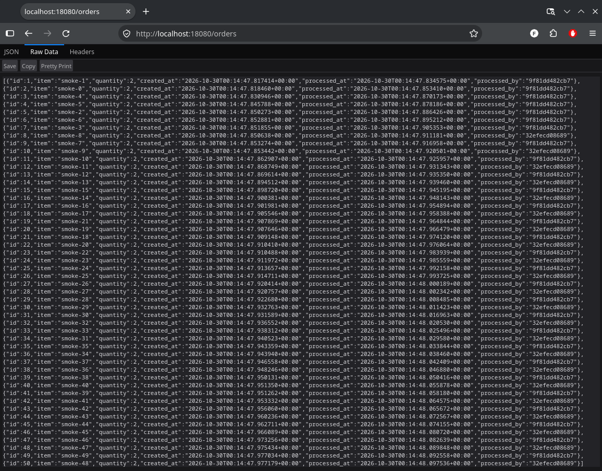
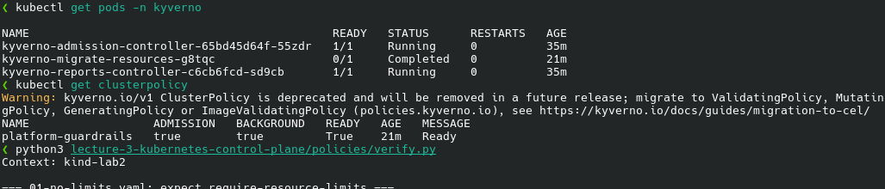
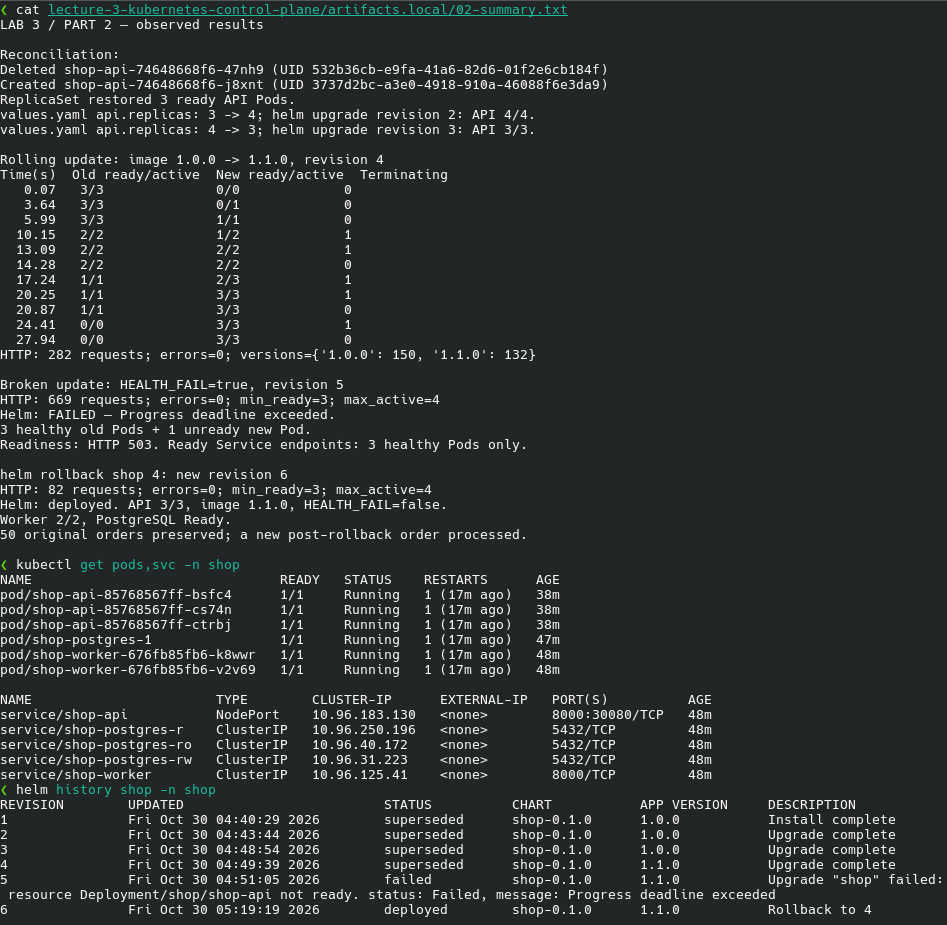
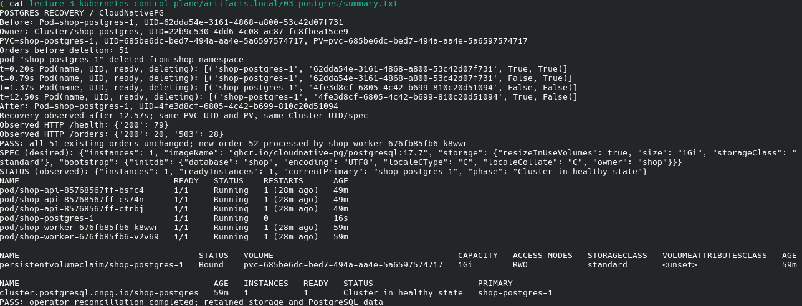
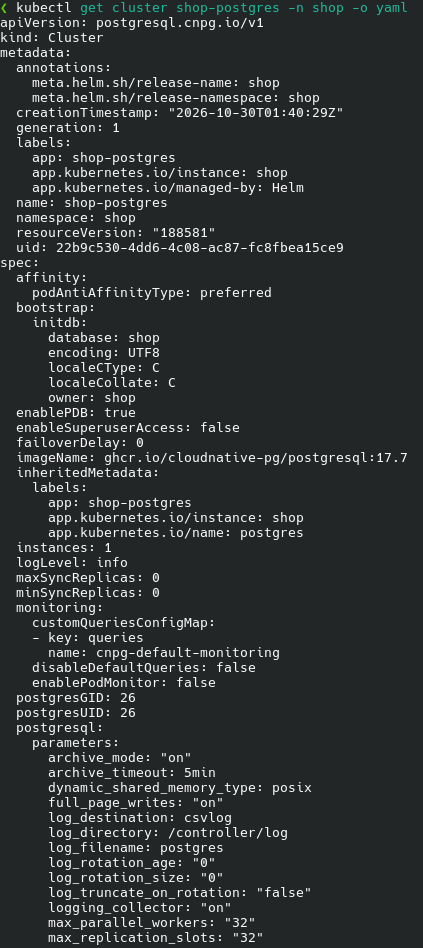
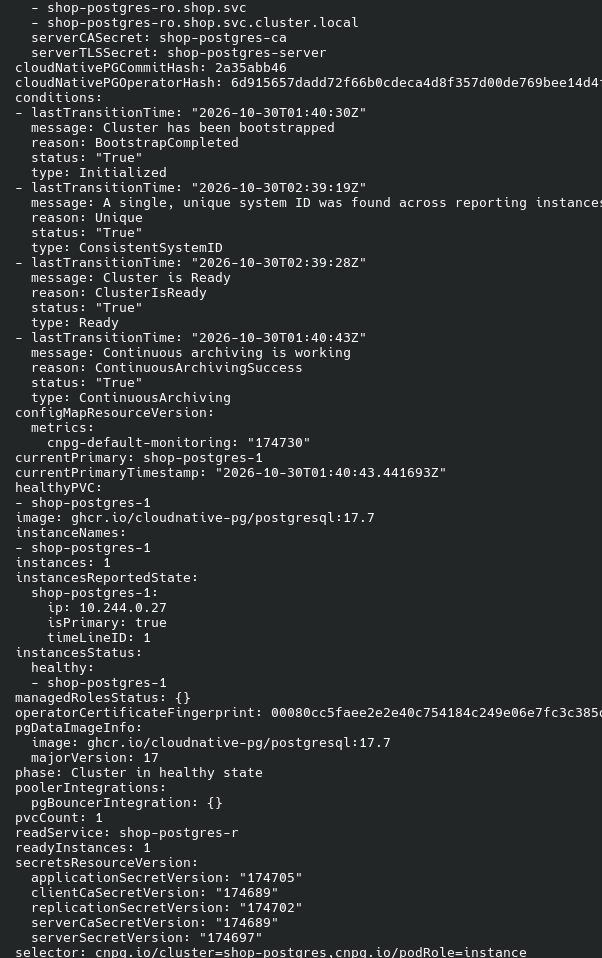

# Лабораторная 3 — Платформа для shop

Продолжил работу в локальном kind-кластере `lab2` из второй лабораторной. Для приложения подготовил namespace `shop`, Kyverno установил в `kyverno`. Существующий мониторинг в `monitoring` оставил без изменений.

## Сервисы и проверка заказов

Сделал API и worker на Python. API принимает заказы через `POST /order`, сохраняет их в PostgreSQL и возвращает через `GET /orders`. Worker читает необработанные заказы и заполняет `processed_at` и `processed_by`. У обоих сервисов есть `/health` и `/metrics`; переменная `HEALTH_FAIL=true` включает ответ 503 на `/health` для будущего эксперимента со сломанным обновлением.

Для нескольких worker использовал `FOR UPDATE SKIP LOCKED`: обработчик блокирует выбранную строку, остальные пропускают её и берут другие заказы. Выбор и обновление выполняются в одной транзакции. Создание таблицы при одновременном старте реплик защитил advisory lock.

Собрал образ `docker.io/library/shop:1.0.0` и проверил его в отдельном Compose-окружении с PostgreSQL 17.7 и двумя worker. Все 50 параллельных запросов создания вернули 201, заказы получили разные ID и обработались. Обычный `/health` вернул 200, намеренно сломанный — 503, некорректный заказ — 422. Метрики доступны. Код и команды проверки находятся в [services](services/README.md).

На [скриншоте списка заказов](screenshots/0-test-orders-api.png) видны заполненные поля обработки и идентификаторы обоих worker.

## Политики на кластер

Выбрал Kyverno: для этих проверок достаточно YAML, не нужно писать правила на Rego. Установил официальный Helm-чарт `kyverno/kyverno` 3.9.2 с приложением v1.19.2. В репозитории оставил свой values-файл и скрипт установки, исходники стороннего чарта не копировал. Для локального стенда использовал по одной реплике admission и reports controller; ненужные здесь background и cleanup controller отключил.

В `ClusterPolicy/platform-guardrails` добавил пять правил в режиме `Enforce`:

| Правило | Проверка и её польза |
| --- | --- |
| `require-resource-limits` | Положительные CPU/memory limits у обычных и init-контейнеров ограничивают потребление ресурсов ноды. |
| `require-app-label` | Непустая метка `app` позволяет выбирать приложение в Service и мониторинге. |
| `trusted-image-sources` | Только Docker Library и `ghcr.io/cloudnative-pg`: ограничивает источники образов, но не проверяет их подписи. |
| `disallow-privileged` | Запрещает privileged-контейнеры, чтобы не снимать ограничения контейнерной изоляции. |
| `disallow-host-namespaces` | Запрещает `hostNetwork`, `hostPID` и `hostIPC`, чтобы приложение не разделяло эти пространства с нодой. |

Политика действует во всех прикладных namespace, включая новые. Исключил инфраструктуру: `kube-system`, `kube-public`, `kube-node-lease`, `local-path-storage`, `kyverno`, `monitoring`, `cnpg-system`. Системным компонентам могут требоваться другие образы и доступ к хосту. Namespace `shop` проверяется полностью, включая будущие Pod базы данных.

После установки оба контроллера работают в состоянии `1/1 Running`, политика — `Ready=True`. Это видно на [скриншоте Kyverno](screenshots/1-kyverno.png).

Для каждого правила подготовил отдельный сырой Pod-манифест: без limits, с чужим образом, без метки, с `privileged: true` и с `hostNetwork: true`. Все пять запросов `kubectl create` были отклонены webhook, каждый — ровно своим правилом. Полный вывод сохранил в [evidence/01-policies.txt](evidence/01-policies.txt).

Ещё 13 проверок подтвердили допустимые Pod, обработку коротких имён образов, запрет нарушений также в `default`, защиту init-контейнеров и проверку Deployment. Корректный Deployment прошёл, а шаблон без limits отклонило правило `autogen-require-resource-limits`. Итог — [PASS для всех 18 проверок](screenshots/1.1-verify-result.png).

Admission отклоняет объект до сохранения в etcd: запрещённый Pod не доходит до запуска. Для Deployment Kyverno автоматически проверяет Pod template. При этом установка политики не удаляет уже работающие Pod — ограничения применяются к новым CREATE/UPDATE.

## Helm-чарт и reconciliation

Написал собственный [Helm-чарт shop](shop/README.md): Deployment и Service для API и worker, по умолчанию 3 и 2 реплики. В шаблоны сразу включил требования политик, readiness и liveness на `/health`. Чарт прошёл `helm lint` и server dry-run, установка завершилась без отклонений Kyverno.

Для рабочего API сразу подготовил PostgreSQL через CloudNativePG: установил официальный чарт оператора 0.29.1 с приложением 1.30.1, а объект `Cluster` добавил в свой чарт. База использует PVC на 1 GiB; строка подключения передаётся приложениям из Secret. Проверку восстановления самой БД оставил на часть 3. В Kubernetes повторил проверку 50 заказов — все сохранились и обработались обоими worker.

Удалил один API Pod через `kubectl delete pod`: ReplicaSet создал замену с новым UID и вернул три готовые реплики. Затем поменял `api.replicas` в `values.yaml` с 3 на 4 и выполнил `helm upgrade` — получил `4/4`. Вернул три реплики тем же способом. Helm изменяет желаемое состояние, а Kubernetes продолжает поддерживать его после завершения команды.

Для rolling update поменял образ API с 1.0.0 на 1.1.0. Задал `maxSurge: 1`, `maxUnavailable: 0` и `minReadySeconds: 5`: сначала добавляется новая реплика, после её устойчивой готовности убирается старая. Во время обновления опрашивал `/health` через NodePort Service и наблюдал Pod. Реплики заменялись последовательно, готовых было не меньше трёх, активных — не больше четырёх. В ответах по заголовку `X-Shop-Version` видны обе версии.

После этого включил `api.healthFail: true` и снова сделал upgrade. Новый Pod остался `0/1`, readiness возвращала 503, обновление завершилось с `Progress deadline exceeded`. Три исправных Pod сохранились; в готовых endpoints Service были только они. Перезапуски сломанного контейнера через liveness не помогали, поскольку причина оставалась в переменной окружения.

Выполнил явный `helm rollback shop 4`: Helm создал ревизию 6 с рабочей конфигурацией ревизии 4. Во всех трёх интервалах наблюдения Service продолжал отвечать:

| Эксперимент                  | Запросы к `/health` | Ошибки |
| ---------------------------- | ------------------- | ------ |
| Rolling update 1.0.0 → 1.1.0 | 282                 | 0      |
| Сломанное обновление         | 669                 | 0      |
| Rollback на ревизию 4        | 82                  | 0      |

После отката все 50 заказов остались в БД, новый заказ тоже создался и обработался. Вернул `healthFail: false` в `values.yaml`, чтобы следующее обновление не включило сбой повторно.

На [скриншоте проверки](screenshots/2-helm-and-reconciliation.png) собраны сохранённые результаты экспериментов: замена удалённого Pod, масштабирование до четырёх реплик, последовательный rolling update и число успешных запросов. Ниже видны готовые Pod и Service после отката, а также история Helm: неудачная ревизия 5 и рабочая ревизия 6 с `Rollback to 4`.

## PostgreSQL через оператор

Продолжил проверку CloudNativePG, установленного для запуска приложения. Собственный чарт описывает PostgreSQL объектом `Cluster/shop-postgres`, а оператор создаёт Pod, PVC, Secret и Service. CRD `clusters.postgresql.cnpg.io` добавляет в API Kubernetes новый тип объектов. У Pod базы в `ownerReferences` указан этот Cluster: CloudNativePG использует собственный контроллер Pod, без StatefulSet.

Удалил Pod `shop-postgres-1` через `kubectl delete pod`. Примерно через 12,6 секунды оператор вернул готовую реплику с тем же именем и новым UID. UID объекта Cluster, его `spec`, UID PVC и имя PV остались прежними. Все 51 существовавший заказ совпали до и после удаления, новый заказ №52 тоже создался и обработался worker.

Во время восстановления отдельно проверял API и доступ к данным. `/health` вернул 79 ответов 200. У `/orders` было 20 ответов 200 и 28 ответов 503: пока единственная реплика PostgreSQL отсутствовала, операции с БД временно не работали. После восстановления они возобновились. Сохранность данных обеспечил прежний PVC; одной реплики недостаточно для непрерывной доступности базы.

На [скриншоте восстановления](screenshots/3.1-postgres-recovery.png) видны разные UID старого и нового Pod, прежний PVC и успешная проверка заказов. Ниже PostgreSQL снова находится в состоянии `Cluster in healthy state`.

В `kubectl get cluster shop-postgres -n shop -o yaml` сравнил желаемое и фактическое состояние:

| Раздел   | Что увидел                                                                                                              |
| -------- | ----------------------------------------------------------------------------------------------------------------------- |
| `spec`   | `instances: 1`, образ PostgreSQL 17.7, БД и владелец `shop`, хранилище `1Gi` класса `standard`                          |
| `status` | `instances: 1`, `readyInstances: 1`, primary `shop-postgres-1`, `phase: Cluster in healthy state`, условие `Ready=True` |

`spec` задаётся через чарт, `status` заполняет оператор. Удаление дочернего Pod не изменило желаемое состояние Cluster, поэтому оператор пересоздал Pod и подключил существующие данные.

В [начале YAML](screenshots/3.2.1-postgres-state.png) видны тип `Cluster`, настройки создания БД, образ и `spec.instances: 1`. Ресурсы и хранилище `1Gi` класса `standard` находятся на [продолжении снимка](screenshots/3.2.2-postgres-state.png).

В [разделе status](screenshots/3.2.3-postgres-state.png) оператор сообщил `Ready=True`, primary `shop-postgres-1` и `readyInstances: 1`. Окончание YAML с топологией и именем сервиса записи — на [последнем снимке](screenshots/3.2.4-postgres-state.png).

Оператор и `kube-controller-manager` используют один принцип reconciliation, но работают на разном уровне. `controller-manager` — часть control plane со встроенными контроллерами общих объектов Kubernetes, например Deployment и ReplicaSet. CloudNativePG устанавливается отдельно, расширяет API через CRD и знает особенности PostgreSQL: primary, реплики, конфигурацию и восстановление. Helm устанавливает объекты, а непрерывно следит за базой именно оператор.

## Проблемы при развёртывании

Первая установка Kyverno завершилась по таймауту: DNS внутри kind не разрешал `reg.kyverno.io`, поды получили `ErrImagePull` и `ImagePullBackOff`. Скачал те же официальные образы на хосте и загрузил через `kind load docker-image`. Повторный `helm upgrade` завершился успешно. Предварительную загрузку включил в скрипт установки.

При проверке образов обнаружил ложный отказ для `shop:1.0.0`. Ожидал, что `image_normalize` добавит `/library/`, но CLI Kyverno показал `docker.io/shop:1.0.0`. Исправил правило на обе формы записи Docker Library и проверил, что посторонние namespace и похожий префикс `library.evil` по-прежнему запрещены.

При первом запуске приложения ждали создания БД и схемы, поэтому TCP startup-пробы временно получали `connection refused`. После подготовки базы все Pod стали готовы без перезапусков. Startup-проба позволила дождаться инициализации до включения liveness.

Между проверкой сломанного обновления и продолжением работы нода kind перезапустилась: в событиях есть `Node Rebooted`, у контейнеров одинаковое время завершения. Поэтому на итоговом стенде у исправных Pod тоже по одному restart. Данные на PVC сохранились. Нулевые ошибки в таблице относятся к записанным интервалам наблюдения, не ко всему времени перерыва.