# Лабораторная 4 — SLA критического пути под перегрузкой

В этой работе защищал оформление заказа `api → postgres`, а фоновой аналитикой `batch` жертвовал при нехватке ресурсов. Взял собственный Helm chart из третьей лабораторной, добавил настройки планирования, ресурсы, приоритеты, бюджеты прерываний и мониторинг. Проверял не только состояние Pod, но и реальные `POST /order`: успешный ответ должен быть `201` с ID сохранённого заказа.

## Batch и тесная площадка

Написал простой Python-процесс: постепенно выделяет заданное число MiB, затем бесконечно нагружает CPU с регулируемым duty cycle. Код и Dockerfile находятся в `batch/`. Размер памяти, скорость выделения, CPU duty, число реплик и ресурсы передаются через values чарта. Реализация не делает полезной работы — это заменитель ночной аналитики.

У batch есть CPU/memory requests и limits, app label, запуск без root, privileged и host namespaces. Политики Kyverno из третьей работы остались в Enforce; исключения для batch не добавлял. Образ собрал и загрузил в обе kind-ноды.

Сохранил существующий kind-кластер с данными PostgreSQL и мониторингом второй работы, присоединил к нему один worker через kubeadm. В результате строго две ноды: `lab2-control-plane` и `lab2-worker`. На моём компьютере 16 ядер CPU, поэтому для воспроизводимой нехватки уменьшал allocatable через kubeReserved.cpu. Это резерв на уровне ноды: планировщик считает площадку тесной, хотя реальная фоновая нагрузка может использовать совсем немного CPU.

На [снимке настройки площадки](screenshots/resources-threshholds.png) видно резервирование 11864m CPU на control-plane и 13944m на worker. Скрипт дождался, пока новые значения allocatable появились в API Kubernetes, и только после этого запускал batch.

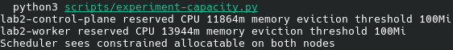

## Разнесение API

В values добавил выбор между podAntiAffinity и topologySpreadConstraints. Выбрал второй вариант: maxSkew=1, DoNotSchedule, minDomains=2, topologyKey=hostname. Две реплики оказались на разных нодах. При отказе одной ноды оставшаяся API-реплика может продолжать принимать заказы; сама база при одной instance всё ещё остаётся единственной точкой отказа.

Жёсткая anti-affinity запрещала бы двум API соседствовать вообще: третья реплика при двух нодах осталась бы Pending. Spread ограничивает перекос и допускает, например, 2:1 при трёх репликах. minDomains=2 делает потерю второго домена явной: под отсутствующей ноды не переносится автоматически рядом с выжившей репликой сверх допустимого перекоса.

Во время rolling update поймал нюанс: старые Pod временно уравновешивали новые, после их удаления две новые реплики могли остаться на одной ноде. Добавил matchLabelKeys=pod-template-hash, чтобы считать каждую ревизию отдельно. После финального обновления проверил размещение ещё раз.

На [снимке разнесения](screenshots/01-spread.png) обе ноды Ready. API `shop-api-58b6dd6cbd-7sr7z` работает на `lab2-worker`, а `shop-api-58b6dd6cbd-rtbl7` — на `lab2-control-plane`. Обе реплики 1/1 Running, перезапусков нет.

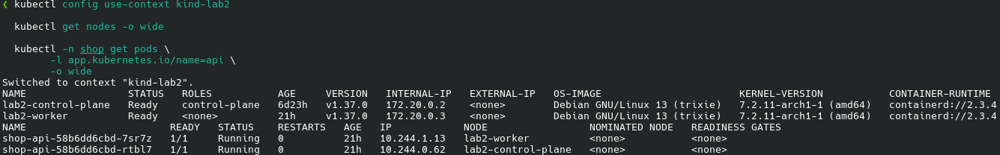

## Ресурсы по krr

Prometheus уже собирал cAdvisor и kube-state-metrics, поэтому krr получил настоящее потребление контейнеров. Нагрузку создавал k6 на путь оформления заказа, не на `/health`. Изначальная догадка по requests была 50m/64Mi для API, 25m/64Mi для worker и 100m/128Mi для PostgreSQL.

Обнаружилось ограничение krr v1.31.1: CloudNativePG создаёт Pod напрямую, поэтому обычный discovery не видит его как StatefulSet. Добавил read-only адаптер, который читает настоящий Cluster и его PostgreSQL Pod. Адаптер расширяет discovery, а метрики и рекомендации обрабатывает штатный код krr.

Для подбора ресурсов профилировал приложение с запасом CPU и памяти при 30 заказах/с. Использовал стратегию simple-limit: CPU request p100 = limit p100, память max+100%. Такой профиль учитывает пики и оставляет запас для служебных процессов. После анализа прописал рассчитанные krr значения в values и применил их через Helm:

| Компонент | Изначальная догадка requests | Финальный request krr | Финальный limit |
|---|---|---|---|
| API | 50m / 64Mi | 486m / 131Mi | 486m / 131Mi |
| worker | 25m / 64Mi | 217m / 100Mi | 250m / 128Mi |
| PostgreSQL | 100m / 128Mi | 870m / 212Mi | 870m / 212Mi |

Исходная оценка недооценивала CPU под нагрузкой и потребности служебного instance manager. 100Mi у worker — минимальный порог стратегии, а не потребление ровно 100Mi. Часовая история и points_required=20 — лабораторное сокращение; предупреждение krr NotEnoughHistoryAvailable сохранено. Для production такой короткой выборки недостаточно. Рабочий профиль проверил на целевой нагрузке 10 заказов/с; результаты приведены в разделе SLA.

Полный отчёт krr, по которому настроил chart, сохранён в [evidence/krr.json](evidence/krr.json). Значения в values сверены с его рекомендациями.

На [снимке krr](screenshots/02-krr.png) показан контроль ресурсов при целевой нагрузке 10 заказов/с. Слева от стрелки видны установленные значения, справа — рекомендации для текущего окна наблюдения:

| Компонент | CPU request = limit для текущей нагрузки | RAM request = limit для текущей нагрузки |
|---|---:|---:|
| API | 74m | 100Mi |
| worker | 54m | 100Mi |
| PostgreSQL | 171m | 106Mi |
| batch | 100m | 139Mi |

Рекомендации для 10 заказов/с ниже значений, выбранных по профилированию на 30 заказах/с. Сохранил в chart профиль с запасом: снижение потребления в текущем окне не означает, что можно убрать ресурсы, потребовавшиеся на пиках. На снимке также видны параметры стратегии и предупреждение о недостаточной истории. Установленные ресурсы подтверждаются JSON krr, а таблица на снимке показывает оценку для текущей нагрузки.

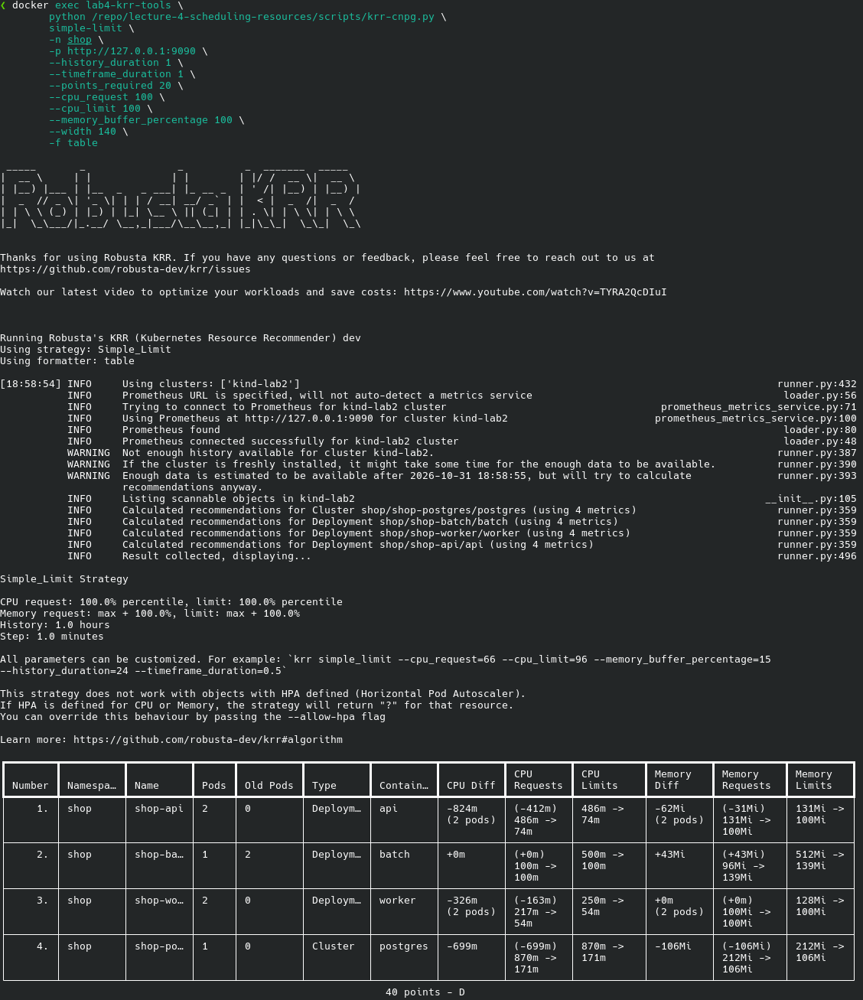

## Приоритеты, QoS и PDB

У API и PostgreSQL requests=limits одновременно для CPU и памяти, фактический QoS — Guaranteed. PriorityClass shop-critical имеет значение 100000. У batch requests ниже limits, QoS Burstable, priority=-1000. Его preemptionPolicy=Never запрещает ему самому вытеснять другие Pod, но не защищает от более приоритетного API.

PDB API сохраняет минимум одну доступную реплику при добровольном eviction. PDB primary PostgreSQL с minAvailable=1 создаёт CNPG по enablePDB из chart values; второй перекрывающий бюджет не добавлял. При одной БД drain через Eviction API блокируется ожидаемо. PDB не спасает от отказа ноды, kubelet eviction или cgroup OOM; scheduler учитывает его при preemption best effort.

Почему Guaranteed и приоритет — разные настройки? Scheduler при preemption использует requests и priority, а не QoS. При давлении памяти kubelet сначала учитывает превышение memory request, затем priority и величину превышения. Batch, использующий память выше своего маленького request, становится предпочтительной жертвой. Guaranteed лучше защищён, но абсолютной защиты от исчерпания всех ресурсов нет.

На [снимке QoS и бюджетов](screenshots/03-qos.png) у обеих API и PostgreSQL действительно Guaranteed и priority=100000; у batch Burstable и priority=-1000, у worker Burstable и обычный приоритет 0. Счётчики перезапусков равны нулю. PDB API допускает одно добровольное прерывание, PDB единственного primary PostgreSQL — ни одного.

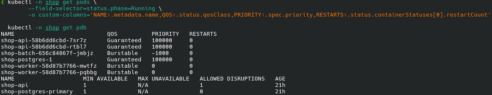

## Pending и preemption

Увеличил batch.replicas до 8 через Helm. У новых Pod requests=500m, хотя CPU duty всего 0,02. Часть осталась Pending с FailedScheduling / Insufficient cpu. Свободный фактический CPU не помог: планировщик суммирует requests уже назначенных Pod.

На [снимке Pending](screenshots/04-pending.png) Helm upgrade завершился успешно, но часть batch осталась без NODE. В событиях явно написано `0/2 nodes are available: 2 Insufficient cpu` и `preemptionPolicy=Never`. API и PostgreSQL при этом Running. Успешный статус Helm без `--wait` означает применение объектов, а не готовность всех реплик. Строки batch с Error — уже завершённые Pod; новые Pending имеют возраст около 30 секунд. Причину нехватки ресурсов показывают свежие события FailedScheduling.

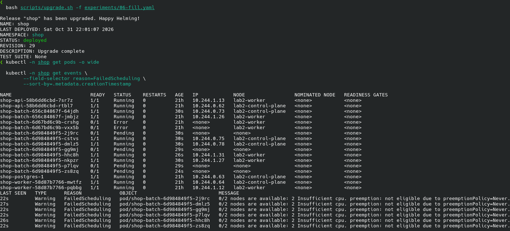

Одного увеличения batch недостаточно для preemption: работающий API уже имеет место. Поэтому следующим Helm upgrade увеличил API с двух до четырёх реплик. Новым высокоприоритетным Pod понадобились занятые слоты, scheduler вытеснил два batch Pod — по одному на каждой ноде. В событиях записано Preempted by pod с UID новых API. Все четыре API стали Ready, после опыта вернул две реплики и обычную ёмкость площадки.

[Снимок preemption](screenshots/05-preemption.png) показывает успешный rollout четырёх API: по две реплики на каждой ноде. Ниже записаны свежие события вытеснения batch `shop-batch-6d984849f5-dmlz5` на control-plane и `shop-batch-6d984849f5-hhc8h` на worker, с UID вытеснивших API. Это именно scheduler preemption, а не ручное удаление batch.

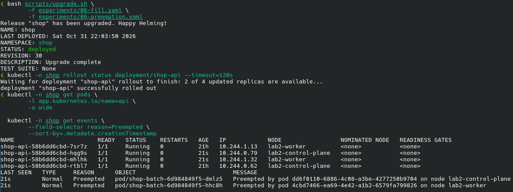

ShopBatchUnschedulable перешёл в firing; его состояние показано на скриншоте в разделе мониторинга.

## MemoryPressure, eviction и контроль OOM

В kind memory eviction по умолчанию выключен. Установил на worker порог на 384Mi ниже текущего available — получилось 22723Mi. Это специально высокий лабораторный порог, а не исчерпание всех 24Gi физического хоста. Batch постепенно выделял 768Mi при собственном limit=1Gi, чтобы пересечь настоящий порог kubelet без исчерпания памяти ноутбука.

На [снимке eviction](screenshots/06-eviction.png) справа виден переход MemoryPressure из False в True. Слева — два события Evicted для batch `shop-batch-6d67bd6c9b-wmc2w` и `shop-batch-6d67bd6c9b-ztbrr`. Kubelet указал использование 266932Ki и 393140Ki, примерно 261Mi и 384Mi: выше request=96Mi, но ниже limit=1Gi. Новые batch временно не пускала memory-pressure taint. API и PostgreSQL остались Guaranteed с теми же именами и нулевыми перезапусками.

Обычный kubectl может показать жертву как Error, но у самого Pod reason=Evicted и сообщение The node was low on resource: memory. Поэтому для диагноза смотрел полный status и события, а не только колонку STATUS.

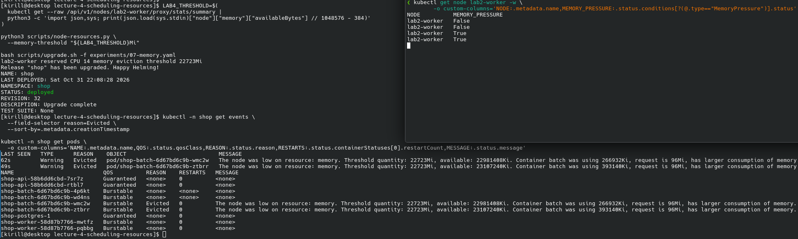

После снятия давления памяти запустил отдельный контроль: batch пытался выделить 256Mi при limit=128Mi. На [снимке OOM-контроля](screenshots/07-oom.png) виден этот batch — `shop-batch-5fbbb6c6cb-mtvlc`: limit=128Mi, LAST_REASON=OOMKilled, RESTARTS=2. Пока снимал, контейнер успел превысить лимит повторно. У Evicted Pod счётчики остались нулевыми, LAST_REASON отсутствует. Eviction завершает весь Pod ради ресурсов ноды, а OOMKilled — контейнер по собственному cgroup-лимиту, после чего kubelet может перезапустить его внутри того же Pod.

В начале того же снимка есть опечатка в команде: `--timeout 3` отклонён Helm, потому что не указана единица времени. Исправил на `--timeout 3m`, после чего восстановление прошло. Порог памяти для OOM-контроля на снимке возвращён к 100M — это десятичные мегабайты, а не MiB; после всего опыта скрипт восстановления вернул рабочий порог 100Mi.

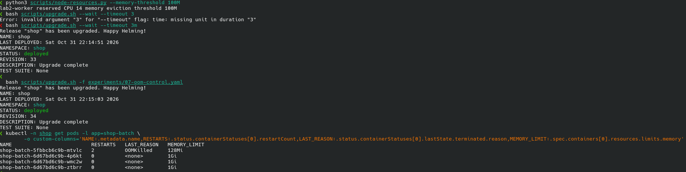

В конце вернул обычный batch 64Mi с limit=512Mi.

## SLA под перегрузкой

Задал SLA для 10 POST /order в секунду: клиентский p95 <300 мс, HTTP-ошибок <1%, dropped_iterations=0. k6 дополнительно проверяет ID сохранённого заказа. Это SLA синхронного пути API → PostgreSQL; время фоновой обработки worker в него не входит. Нагрузка 30 заказов/с использовалась для профилирования ресурсов; SLA проверял на целевых 10 заказах/с.

На [снимке запуска k6](screenshots/k6-load.png) видны сценарий 10 iterations/s, длительность 30 минут и первые 54 завершённые итерации без прерванных. На этом кадре виден запуск сценария, а его поведение под перегрузкой показано на графиках Grafana.

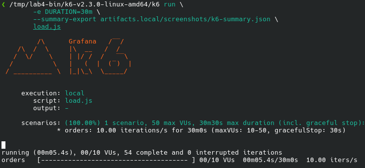

Для численной проверки SLA использовал статистику k6 по завершённым контрольным интервалам: [штатная нагрузка](evidence/sla-steady.json), [CPU/preemption](evidence/sla-cpu.json) и [давление памяти](evidence/sla-memory.json). Таблица не является сводкой всего 30-минутного сценария.

| Интервал | Заказов | Клиентский p95 | HTTP-ошибки | Dropped iterations |
|---|---:|---:|---:|---:|
| Финальный профиль, штатная минута | 601 | 30,68 мс | 0 | 0 |
| CPU requests, Pending, preemption, 4 минуты | 2400 | 27,87 мс | 0 | 0 |
| MemoryPressure, eviction и отдельный OOM-контроль batch, 4 минуты | 2401 | 29,66 мс | 0 | 0 |

Проверил окна по 10 секунд, чтобы общий p95 не скрыл короткий провал: наихудший оконный p95 — 30,54 мс в CPU-опыте и 31,36 мс в опыте с памятью. Все ответы прошли проверку ID. Деградировал batch: Pending, preemption, eviction и OOM в отдельном контроле; критический путь продолжал отвечать.

Два графика ниже построены автоматически из измерений k6 скриптом [scripts/plot-sla.py](scripts/plot-sla.py). Исходные точки получал через `k6 run --out json=results/load.json load.js`. В JSON-потоке каждая точка содержит время, имя метрики и её значение. Обработка такая:

1. Разбил точки на неперекрывающиеся десятисекундные окна по времени измерения.
2. В каждом окне вычислил `numpy.percentile(values, 95)` для `http_req_duration` — это верхняя кривая в миллисекундах.
3. Для нижней кривой усреднил значения `http_req_failed` (0 — успех, 1 — ошибка) и умножил результат на 100, получив процент HTTP-ошибок.

Полученные окна сохранены в [sla-cpu-windows.json](evidence/sla-cpu-windows.json) и [sla-memory-windows.json](evidence/sla-memory-windows.json). Красные горизонтальные линии — заданные границы SLA 300 мс и 1%, вертикальные отметки — время этапов из [sla-events.json](evidence/sla-events.json). Ось времени подписана в UTC. В таблице выше p95 рассчитан по всему контрольному интервалу, а на графике каждая точка относится только к своему десятисекундному окну.

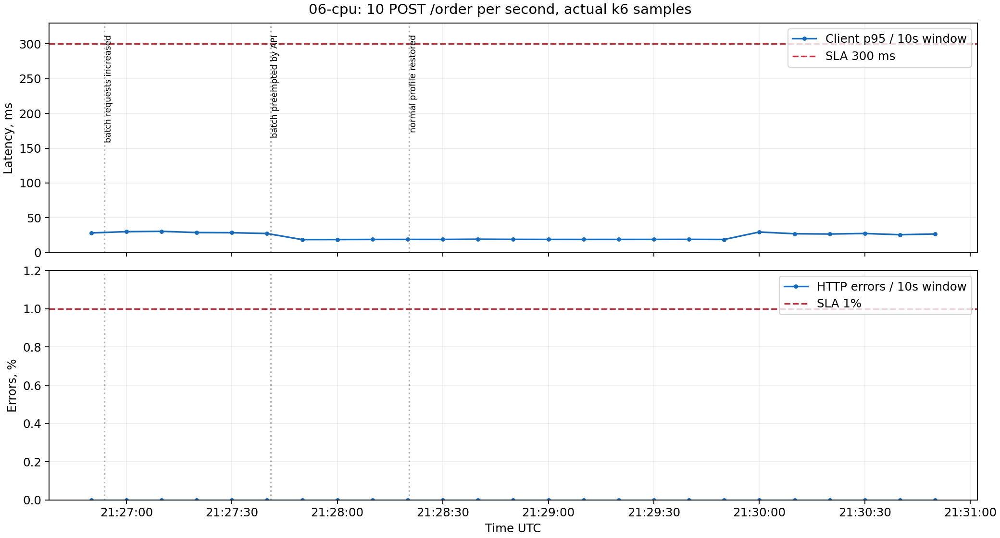

Эти графики дополняют Grafana. k6 измеряет длительность HTTP-запроса со стороны клиента: отправку запроса, ожидание и получение ответа; DNS и установление TCP/TLS-соединения в `http_req_duration` не входят. Grafana показывает время обработки внутри API по метрикам Prometheus и оценивает p95 через `histogram_quantile` по корзинам гистограммы. Поэтому значения могут различаться: у измерений разные границы, способы вычисления и окна агрегации. Ошибки, при которых запрос вообще не дошёл до API, также видны на стороне k6.

[Grafana во время CPU/preemption](screenshots/08-sla-cpu.png) показывает рост доступных API с двух до четырёх, рост Pending batch до шести и около 10 заказов/с. Серверный p95 находится примерно в диапазоне 25–50 мс, линия ошибок — на нуле.

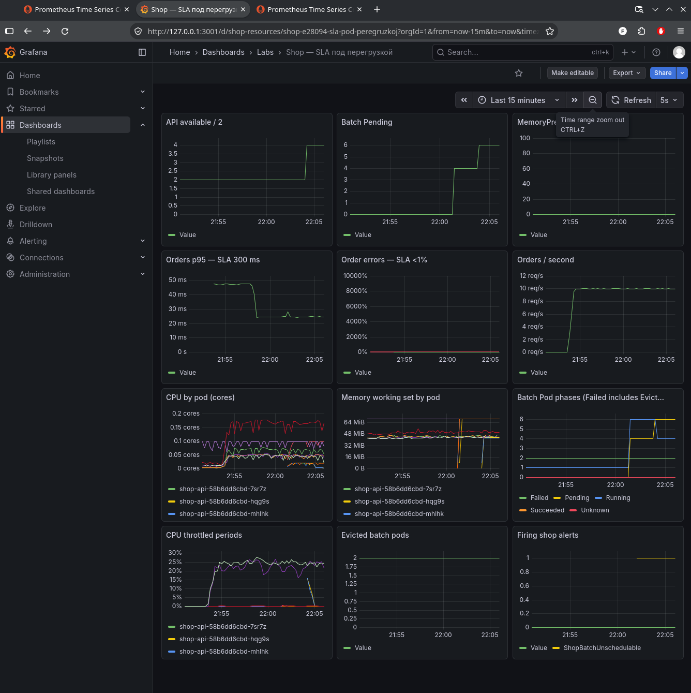

Отдельный [снимок памяти](screenshots/09-sla-memory.png) показывает MemoryPressure=1 и два Evicted batch. Падение счётчика Evicted до нуля между этапами не означает восстановления завершённых Pod: состав учитываемых объектов изменился, а затем появились новые жертвы.

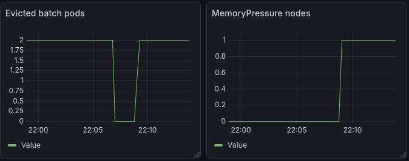

## Дашборд и алерты

Использовал существующие Prometheus, Grafana и Alertmanager Лабы 2. В chart лежат два ServiceMonitor, PrometheusRule с тремя правилами и ConfigMap дашборда. В этом стеке обычный Prometheus, без Operator: адаптер из Лабы 3 переводит CR в overrides существующих Helm releases и проверяет загруженные правила через API. Старые правила и RED-дашборд Лабы 2 сохранены. Сторонние chart не копировал в репозиторий.

Дашборд Shop — SLA под перегрузкой показывает 12 панелей: p95, ошибки и RPS заказов, доступность API, CPU, working set и throttling контейнеров, Pending/Running/Evicted batch, MemoryPressure и firing alerts. Клиентский k6 учитывает сетевую задержку и запросы, которые не дошли до приложения; метрики API показывают серверную сторону. Поэтому опирался на оба источника.

| Алерт | Условие и зачем он нужен |
|---|---|
| ShopOrderSLOBreach | p95 >300 мс или не-201 >1% за 2 минуты при >=20 запросов, for=30s. Проверяет критический путь. |
| ShopBatchUnschedulable | Есть unschedulable batch в течение 30 секунд. Показывает нехватку ресурсов для аналитики, даже когда заказы работают. |
| ShopNodeMemoryPressure | Нода находится в MemoryPressure 30 секунд. Помогает искать eviction и проверить сохранность критического пути. |

На [полном живом дашборде](screenshots/10-dashboard.png) видны оба этапа перегрузки: API сначала 2 → 4 → 2, Pending batch до шести при нехватке CPU, затем MemoryPressure=1 и два Evicted batch. Поток заказов остаётся около 10/с; p95 примерно 25–40 мс, ошибки — ноль. В нижней правой панели отмечены срабатывания ShopBatchUnschedulable и ShopNodeMemoryPressure.

На снимке у панели ошибок слишком широкий автоматический масштаб — до 10000%. Поэтому не определял малую долю ошибок по одному положению линии на таком масштабе: учитывал численные результаты k6. Значения 25–50 мс на Grafana — оценка серверного p95 по histogram buckets, а точные клиентские p95 приведены отдельно в таблице.

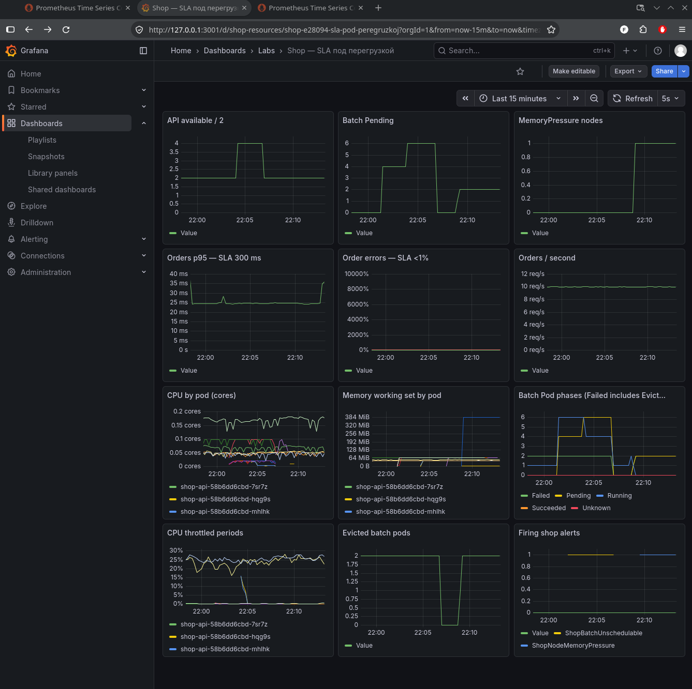

На [снимке Prometheus Alerts](screenshots/11-alert-firing.png) раскрыт ShopBatchUnschedulable: state=FIRING, value=4, for=30s. ShopOrderSLOBreach и ShopNodeMemoryPressure в этот момент inactive. Выше видны три сохранённых правила Лабы 2, тоже inactive.

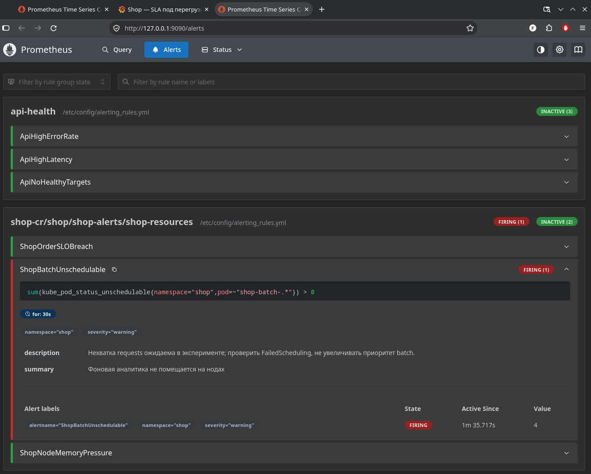

Численные результаты k6, данные десятисекундных окон и клиентские графики сохранены в evidence. Они позволяют проверить результаты после истечения шестичасового retention Prometheus. Порядок запуска стенда и опытов — в [REPRODUCE.md](REPRODUCE.md).

## Неожиданные проблемы

На новой worker-ноде не разрешались внешние registry, поэтому DaemonSet мониторинга сначала получил ImagePullBackOff. Загрузил те же образы с хоста через kind load docker-image, затем пересоздал неуспешные Pod. После этого Alloy и node-exporter работают на обеих нодах.

Для krr понадобился Python 3.12, а на хосте 3.14. Подготовил отдельный временный контейнер; pip внутри него не разрешал DNS, поэтому скачал зависимости для Python 3.12 на хосте и установил offline. Это окружение измерителя, не часть приложений shop.

При настройке krr окно rate 15 секунд совпало с интервалом scrape 15 секунд. Для rate нужны хотя бы две точки, поэтому CPU-оценка получалась ненадёжной. Переключил timeframe на минуту и пересчитал рекомендации.

Для Guaranteed недостаточно механически превратить типичный CPU request в жёсткий limit: это может вызвать throttling и таймауты probes и lease CNPG. Поэтому использовал simple-limit с p100, проверил профиль нагрузкой и настроил startup/liveness probes через chart. Для служебного instance manager указал GOMAXPROCS=1. У CNPG стандартный stopDelay равен 1800 секундам; для лабораторного стенда установил stopDelay=30 и smartShutdownTimeout=10, чтобы восстановление не затягивалось. PVC с данными сохранил.

Также исправил учёт ReplicaSet при topology spread. Обе проблемы проявились при реальном обновлении, а не были замечены только по YAML.
