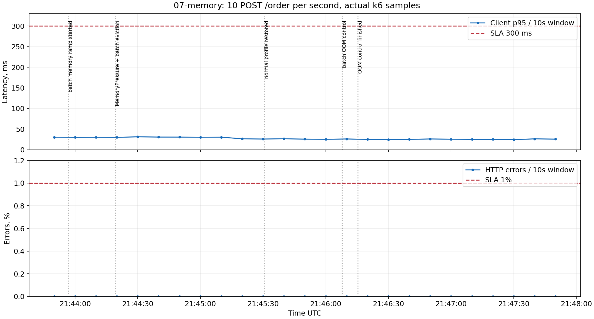
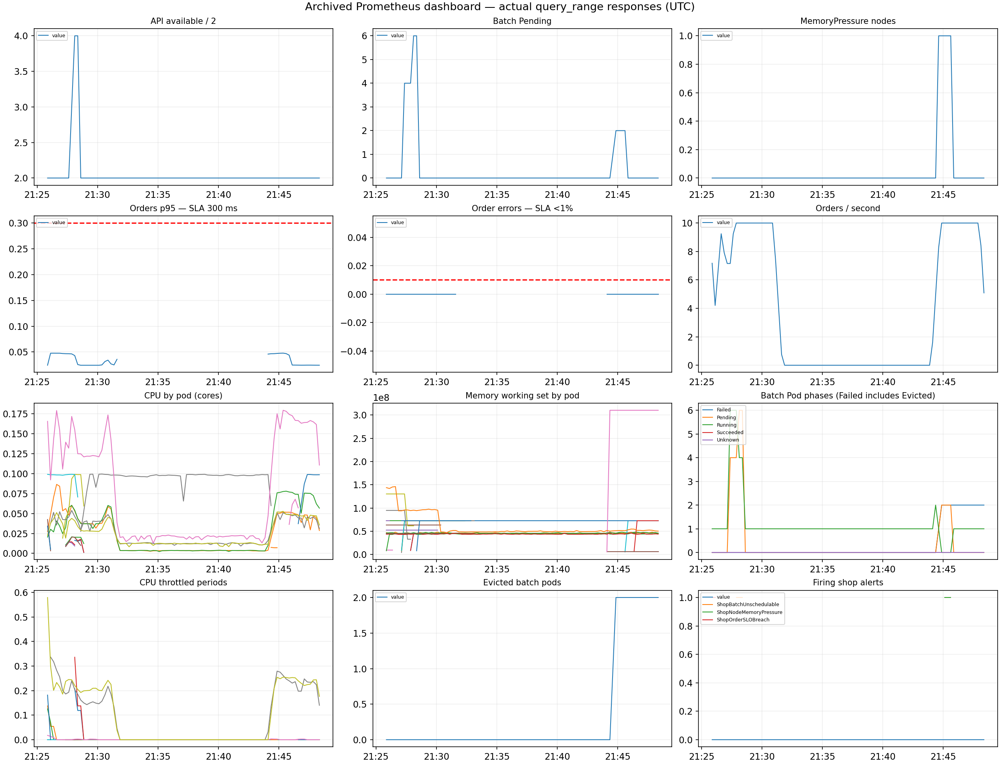

# Лабораторная 4 — SLA критического пути под перегрузкой

В этой работе защищал оформление заказа `api → postgres`, а фоновой аналитикой `batch` жертвовал при нехватке ресурсов. Взял собственный Helm chart из третьей лабораторной, добавил настройки планирования, ресурсы, приоритеты, бюджеты прерываний и мониторинг. Проверял не только состояние Pod, но и реальные `POST /order`: успешный ответ должен быть `201` с ID сохранённого заказа.

## Batch и тесная площадка

Написал простой Python-процесс: постепенно выделяет заданное число MiB, затем бесконечно нагружает CPU с регулируемым duty cycle. Код и Dockerfile находятся в `batch/`. Размер памяти, скорость выделения, CPU duty, число реплик и ресурсы передаются через values чарта. Реализация не делает полезной работы — это заменитель ночной аналитики.

У batch есть CPU/memory requests и limits, app label, запуск без root, privileged и host namespaces. Политики Kyverno из третьей работы остались в Enforce; исключения для batch не добавлял. Образ собрал и загрузил в обе kind-ноды.

Сохранил существующий kind-кластер с данными PostgreSQL и мониторингом второй работы, присоединил к нему один worker через kubeadm. В результате строго две ноды: `lab2-control-plane` и `lab2-worker`. На физическом компьютере 16 CPU, поэтому для воспроизводимой нехватки уменьшал allocatable через kubeReserved.cpu. Это резерв на уровне ноды: планировщик считает площадку тесной, хотя реальная фоновая нагрузка может использовать совсем немного CPU.

## Разнесение API

В values добавил выбор между podAntiAffinity и topologySpreadConstraints. Выбрал второй вариант: maxSkew=1, DoNotSchedule, minDomains=2, topologyKey=hostname. Две реплики оказались на разных нодах. При отказе одной ноды оставшаяся API-реплика может продолжать принимать заказы; сама база при одной instance всё ещё остаётся единственной точкой отказа.

Жёсткая anti-affinity запрещала бы двум API соседствовать вообще: третья реплика при двух нодах осталась бы Pending. Spread ограничивает перекос и допускает, например, 2:1 при трёх репликах. minDomains=2 делает потерю второго домена явной: под отсутствующей ноды не переносится автоматически рядом с выжившей репликой сверх допустимого перекоса.

Во время rolling update поймал нюанс: старые Pod временно уравновешивали новые, после их удаления две новые реплики могли остаться на одной ноде. Добавил matchLabelKeys=pod-template-hash, чтобы считать каждую ревизию отдельно. После финального обновления проверил размещение ещё раз.

Доказательства: `evidence/04-spread.txt`, `evidence/05-guarantees.txt` и финальный снимок. Скриншот: две API-реплики с разными значениями NODE.

## Ресурсы по krr

Prometheus уже собирал cAdvisor и kube-state-metrics, поэтому krr получил настоящее потребление контейнеров. Нагрузку создавал k6 на путь оформления заказа, не на `/health`. Изначальная догадка по requests была 50m/64Mi для API, 25m/64Mi для worker и 100m/128Mi для PostgreSQL.

Обнаружилось ограничение krr v1.31.1: CloudNativePG создаёт Pod напрямую, поэтому обычный discovery не видит его как StatefulSet. Добавил read-only адаптер, который читает настоящий Cluster и его PostgreSQL Pod. Алгоритмы стратегии, PromQL loaders и округление krr не менял, фиктивных объектов Kubernetes не создавал.

Первый запуск simple p99 предложил API 61m/100Mi и PostgreSQL 156m/100Mi. Стратегия рекомендует CPU request без limit. Я приравнял limit к request ради Guaranteed и проверил результат: получили сильный throttling, таймауты HTTPS probes и lease CNPG, затем нарушение SLA. Этот неудачный опыт сохранил отдельно, а не включил в успешные результаты. Увеличения таймаутов probes и GOMAXPROCS=1 оказалось недостаточно.

Временно дал API 500m/256Mi, PostgreSQL 1 CPU/256Mi и повторил профилирование на 30 заказах/с. Затем использовал штатную стратегию simple-limit: CPU request p100 = limit p100, память max+100%. Такой профиль учитывает пики и даёт запас на короткую выборку и служебные процессы. Абсолютные значения рассчитаны krr:

| Компонент | Изначальная догадка requests | Финальный request krr | Финальный limit |
|---|---|---|---|
| API | 50m / 64Mi | 486m / 131Mi | 486m / 131Mi |
| worker | 25m / 64Mi | 217m / 100Mi | 250m / 128Mi |
| PostgreSQL | 100m / 128Mi | 870m / 212Mi | 870m / 212Mi |

Исходная оценка недооценивала CPU под нагрузкой и потребности служебного instance manager. 100Mi у worker — минимальный порог стратегии, а не потребление ровно 100Mi. Часовая история и points_required=20 — лабораторное сокращение; предупреждение krr NotEnoughHistoryAvailable сохранено. Для production такой короткой выборки недостаточно. Финальный профиль на 10 заказах/с проверен отдельно: 601 запрос, p95 30,68 мс, ошибок и dropped iterations нет.

Полный финальный отчёт — `evidence/03-krr-final.json`, человекочитаемая сводка — `evidence/03-krr-summary.md`. Сверка values с JSON выполнена автоматически. Скриншот: таблица финальных рекомендаций и параметры стратегии.

## Приоритеты, QoS и PDB

У API и PostgreSQL requests=limits одновременно для CPU и памяти, фактический QoS — Guaranteed. PriorityClass shop-critical имеет значение 100000. У batch requests ниже limits, QoS Burstable, priority=-1000. Его preemptionPolicy=Never запрещает ему самому вытеснять другие Pod, но не защищает от более приоритетного API.

PDB API сохраняет минимум одну доступную реплику при добровольном eviction. PDB primary PostgreSQL с minAvailable=1 создаёт CNPG по enablePDB из chart values; второй перекрывающий бюджет не добавлял. При одной БД drain через Eviction API блокируется ожидаемо. PDB не спасает от отказа ноды, kubelet eviction или cgroup OOM; scheduler учитывает его при preemption best effort.

Почему Guaranteed и приоритет — разные настройки? Scheduler при preemption использует requests и priority, а не QoS. При давлении памяти kubelet сначала учитывает превышение memory request, затем priority и величину превышения. Batch, использующий память выше своего маленького request, становится предпочтительной жертвой. Guaranteed лучше защищён, но абсолютной защиты от исчерпания всех ресурсов нет.

## Pending и preemption

Увеличил batch.replicas до 8 через Helm. У новых Pod requests=500m, хотя CPU duty всего 0,02. Часть осталась Pending с FailedScheduling / Insufficient cpu. Свободный фактический CPU не помог: планировщик суммирует requests уже назначенных Pod.

Одного увеличения batch недостаточно для preemption: работающий API уже имеет место. Поэтому следующим Helm upgrade увеличил API с двух до четырёх реплик. Новым высокоприоритетным Pod понадобились занятые слоты, scheduler вытеснил два batch Pod — по одному на каждой ноде. В событиях записано Preempted by pod с UID новых API. Все четыре API стали Ready, после опыта вернул две реплики и обычную ёмкость площадки.

Алерт ShopBatchUnschedulable успел перейти в firing. Ответ Prometheus сохранён во время Pending, а не создан вручную. Скриншоты: `evidence/06-pending.txt`, `evidence/06-preemption.txt`, `evidence/09-ShopBatchUnschedulable-firing.json`.

## MemoryPressure, eviction и контроль OOM

В kind memory eviction по умолчанию выключен. Установил на worker порог на 384Mi ниже текущего available: было около 23092Mi, порог 22707Mi. Это специально высокий лабораторный порог, а не исчерпание всех 24Gi физического хоста. Batch постепенно выделял 768Mi при собственном limit=1Gi, чтобы пересечь настоящий порог kubelet без исчерпания памяти ноутбука.

Дождался MemoryPressure=True. Первой жертвой стал Burstable batch `shop-batch-6d67bd6c9b-crshg`: kubelet указал использование 341068Ki (около 333Mi), request=96Mi и сообщение The node was low on resource: memory. Потребление выше request, но значительно ниже limit=1Gi. Затем был вытеснен и второй batch; новые Pod временно не пускала memory-pressure taint. API и PostgreSQL сохранили UID, QoS и restartCount=0. Сверка до/после — в `evidence/07-memory-observation.json`.

Обычный kubectl показал жертву как Error: контейнер завершился с exitCode=137 и reason=Error. Но у самого Pod phase=Failed, reason=Evicted и сообщение о нехватке памяти ноды. Поэтому одного кода 137 или колонки STATUS для диагноза недостаточно.

После возврата порога 100Mi провёл отдельный контроль: batch выделял 256Mi при limit=128Mi. Получил lastState.terminated.reason=OOMKilled и restartCount=1 внутри того же Pod. Это kernel/cgroup OOM по собственному лимиту. Eviction завершает весь Pod ради освобождения ресурсов ноды; OOMKilled завершает контейнер, который kubelet может перезапустить. В конце вернул обычный batch 64Mi с limit=512Mi.

Скриншоты: `evidence/07-eviction.txt` с причиной и QoS, `evidence/07-oom-control.txt` для сравнения. Полные JSON также сохранены.

## SLA под перегрузкой

Задал SLA для 10 POST /order в секунду: клиентский p95 <300 мс, HTTP-ошибок <1%, dropped_iterations=0. k6 дополнительно проверяет ID сохранённого заказа. Это SLA синхронного пути API → PostgreSQL; время фоновой обработки worker в него не входит. Проверка на 30 заказах/с была профилированием для krr и не выдаётся за успешный SLA этого стенда.

| Интервал | Заказов | Клиентский p95 | HTTP-ошибки | Dropped iterations |
|---|---:|---:|---:|---:|
| Финальный профиль, штатная минута | 601 | 30,68 мс | 0 | 0 |
| CPU requests, Pending, preemption, 4 минуты | 2400 | 27,87 мс | 0 | 0 |
| MemoryPressure, eviction и отдельный OOM-контроль batch, 4 минуты | 2401 | 29,66 мс | 0 | 0 |

Проверил окна по 10 секунд, чтобы общий p95 не скрыл короткий провал: наихудший оконный p95 — 30,54 мс в CPU-опыте и 31,36 мс в опыте с памятью. Все ответы прошли проверку ID. Деградировал batch: Pending, preemption, eviction и OOM в отдельном контроле; критический путь продолжал отвечать.

На графиках отмечены этапы, реальный preemption/eviction и восстановление. Это отдельные интервалы, без подготовительных сбоев. Начальный прогон на исходных ресурсах дал 2621 запрос и p95 29,22 мс; остановил его вручную через 4 минуты 22 секунды после накопления данных, поэтому k6 записал interrupt. Итоговое доказательство — полностью завершённые прогоны выше с пройденными thresholds.

## Дашборд и алерты

Использовал существующие Prometheus, Grafana и Alertmanager Лабы 2. В chart лежат два ServiceMonitor, PrometheusRule с тремя правилами и ConfigMap дашборда. В этом стеке обычный Prometheus, без Operator: адаптер из Лабы 3 переводит CR в overrides существующих Helm releases и проверяет загруженные правила через API. Старые правила и RED-дашборд Лабы 2 сохранены. Сторонние chart не копировал в репозиторий.

Дашборд Shop — SLA под перегрузкой показывает 12 панелей: p95, ошибки и RPS заказов, доступность API, CPU, working set и throttling контейнеров, Pending/Running/Evicted batch, MemoryPressure и firing alerts. Клиентский k6 учитывает сетевую задержку и запросы, которые не дошли до приложения; метрики API показывают серверную сторону. Поэтому опирался на оба источника.

| Алерт | Условие и зачем он нужен |
|---|---|
| ShopOrderSLOBreach | p95 >300 мс или не-201 >1% за 2 минуты при >=20 запросов, for=30s. Проверяет критический путь. |
| ShopBatchUnschedulable | Есть unschedulable batch в течение 30 секунд. Показывает нехватку ресурсов для аналитики, даже когда заказы работают. |
| ShopNodeMemoryPressure | Нода находится в MemoryPressure 30 секунд. Помогает искать eviction и проверить сохранность критического пути. |

Доказал firing второго алерта в CPU-эксперименте. Финальные графики сохранены и как реальные query_range ответы Prometheus, и как PNG: они не пропадут после истечения шестичасового retention. В REVIEW.html видны архивные результаты с датами; это просмотр сохранённых наблюдений, не имитация живого kubectl.

## Неожиданные проблемы

На новой worker-ноде не разрешались внешние registry, поэтому DaemonSet мониторинга сначала получил ImagePullBackOff. Загрузил те же образы с хоста через kind load docker-image, затем пересоздал неуспешные Pod. После этого Alloy и node-exporter работают на обеих нодах.

Для krr понадобился Python 3.12, а на хосте 3.14. Подготовил отдельный временный контейнер; pip внутри него не разрешал DNS, поэтому скачал зависимости для Python 3.12 на хосте и установил offline. Это окружение измерителя, не часть приложений shop.

При первом расчёте выбрал окно rate 15 секунд при scrape каждые 15 секунд. Для rate нужны хотя бы две точки, поэтому CPU-оценка получалась ненадёжной. Переключил timeframe на минуту и пересчитал рекомендации.

Самая существенная проблема — превращение первоначального CPU request krr в жёсткий limit. Это показало, почему рекомендацию нужно проверять под нагрузкой. CNPG после таймаутов не сразу завершал контейнер: его стандартный stopDelay был 1800 секунд. Откатил подготовительный профиль, остановил уже удаляемый зависший контейнер через runtime, сохранив PVC; PostgreSQL восстановился по WAL. Для лабораторного стенда прописал stopDelay=30 и smartShutdownTimeout=10, более терпимые startup/liveness probes, затем повторил измерение и успешную проверку. Настройки сделаны через chart, а не оставлены разовым patch.

Также исправил учёт ReplicaSet при topology spread. Обе проблемы проявились при реальном обновлении, а не были замечены только по YAML.

## Итоговое состояние

Все части 0–9 выполнены. Shop release deployed, revision 28. Две API-реплики находятся на разных нодах и имеют Guaranteed; PostgreSQL Ready и Guaranteed. Worker 2/2, рабочий batch 1/1. У API и PostgreSQL после финального развёртывания нет перезапусков. Два исторических Evicted batch Pod оставлены для просмотра доказательств: это завершённые жертвы опыта, не неисправность работающего Deployment.

CPU allocatable возвращён к рабочему профилю: 4 CPU у control-plane и 2 у worker, memory eviction threshold на обеих нодах 100Mi. Четыре scrape-цели shop UP, три правила здоровы и inactive, старые три правила Лабы 2 сохранены. Правила прошли promtool, chart — helm lint и серверный dry-run с действующими admission-политиками. Финальные resources сверены с JSON krr.

Порядок съёмки — [SCREENSHOTS.md](SCREENSHOTS.md). Кратковременные состояния доступны в REVIEW.html и исходных evidence: повторять перегрузку для скриншотов не нужно.
