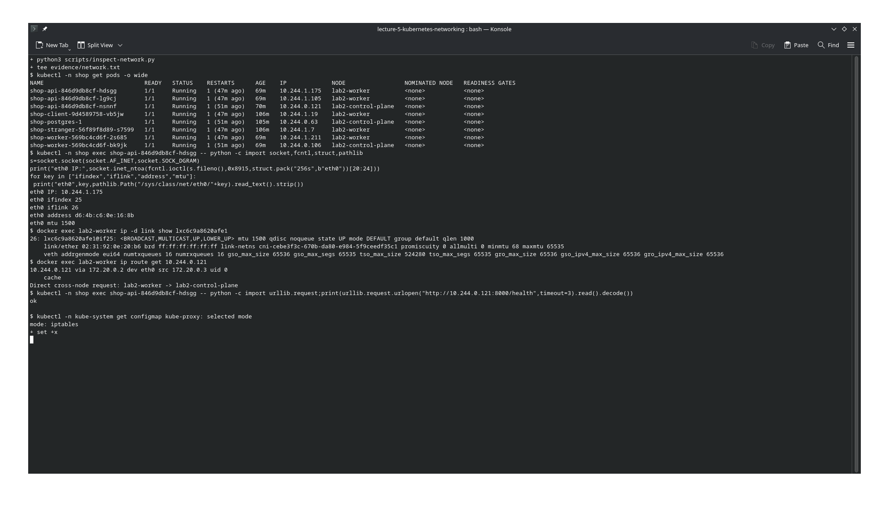
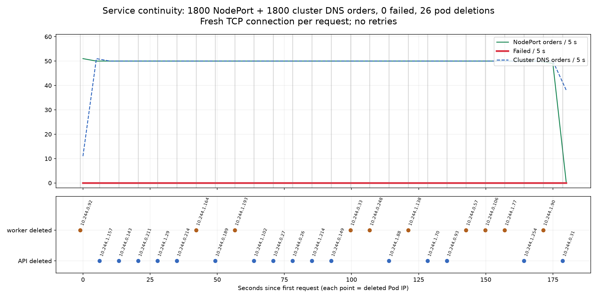
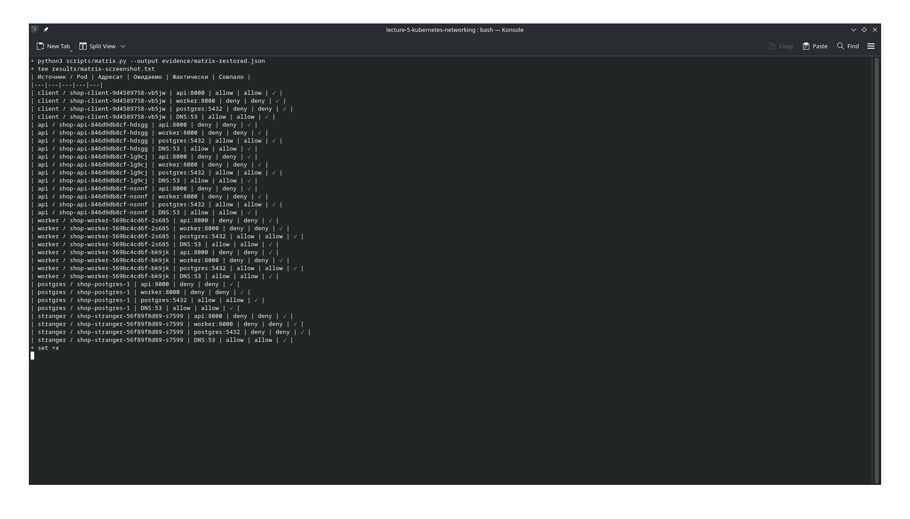
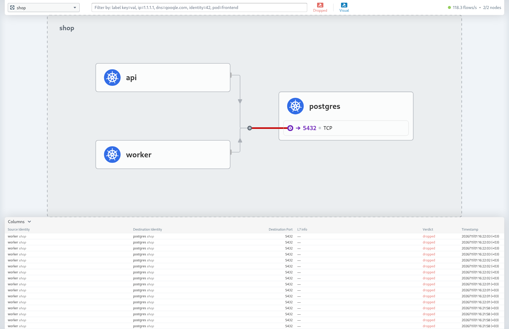
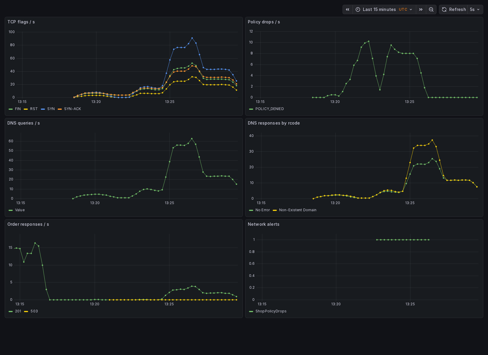
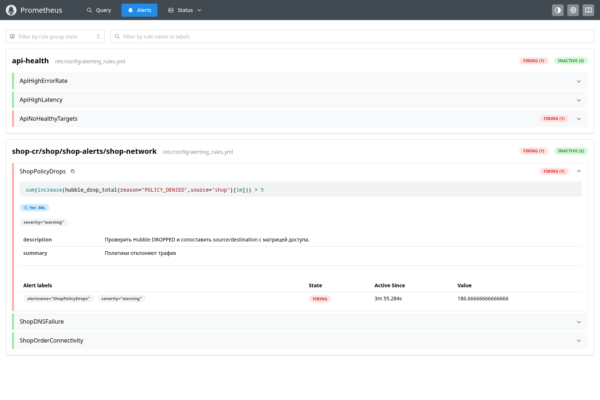

# Лабораторная 5 — Zero-trust сеть с доказательством

## Стенд и выбор CNI

Использовал существующий двухнодовый `kind-lab2` из Лаб 2–4. Prometheus, Grafana, Alertmanager и PostgreSQL на PVC сохранил, новый стек мониторинга не поднимал. Chart `shop` продолжает собственный chart предыдущих работ; убрал batch и опыты с ресурсами, оставил API, worker и CNPG PostgreSQL. Для сетевых проверок добавил client и stranger с тем же образом приложения.

Выбрал Cilium 1.20.4: он применяет NetworkPolicy через eBPF, а Hubble показывает источники, адресатов и причины отбрасывания пакетов. Calico тоже подходит для изоляции, но здесь хотелось проверить диагностику по Hubble. `kindnet` заменил: он принимает объекты NetworkPolicy через Kubernetes API, но сам их не исполняет.

Сохранил kube-proxy, настроил Cilium с `ipam.mode=kubernetes`, native routing и `autoDirectNodeRoutes`. Он использует прежние PodCIDR `10.244.0.0/16`; ноды напрямую маршрутизируют пакеты между своими подсетями. После установки пересоздал старые Pod, чтобы они получили Cilium endpoints. PVC базы не удалял.

Cilium установлен из внешнего Helm repo с закреплённой версией, в репозитории лежат только [overrides](infrastructure/cilium-values.yaml) и [скрипт установки](infrastructure/install-cni.sh). Копировать сторонний chart не нужно; доступные параметры показывает `helm show values cilium/cilium --version 1.20.4`.

Helm chart — пакет из `Chart.yaml`, `values.yaml` и шаблонов `templates/`. Helm объединяет defaults, файлы `-f` и `--set` (последний слой побеждает), рендерит обычные Kubernetes-объекты и применяет их. Результат виден через `helm template`. Установленная копия — release, каждая ревизия хранится в Secret его namespace: на этой истории основан rollback.

Однако: Cilium 1.18.3 падал до готовности на моём ядре `7.2.11-arch1-1`: `failed to probe helper ... FnSetRetval ... R1 is not a scalar`. Нашёл [upstream issue #48016](https://github.com/cilium/cilium/issues/48016): старый probe не учитывает новую проверку аргумента `bpf_set_retval`. Перешёл на **Cilium 1.20.4**, где ошибка исправлена. Это окончательная закреплённая версия стенда; Helm overrides отключают `useDigest`, чтобы kind использовал загруженные локальные образы по тегу.

На Kubernetes 1.37 после неудачного pull одного импорта оказалось недостаточно: kubelet повторно проверял доступ к registry, а с `Never` показывал ErrImageNeverPull при наличии образа в `crictl images`. Настроил `NeverVerifyAllowlistedImages` для репозиториев уже загруженных образов стенда, затем перезапустил kubelet. Механизм описан в [документации Kubernetes](https://kubernetes.io/docs/concepts/containers/images/#ensure-image-pull-credential-verification). Настройка и загрузка включены в `infrastructure/preload-images.py`.

## Сеть Pod

При создании Pod runtime создаёт network namespace, а Cilium через CNI выдаёт IP из PodCIDR ноды, настраивает `eth0`, маршруты и парный veth. Один конец находится в namespace Pod, другой (`lxc…`) — в namespace ноды. На veth/интерфейсах Cilium ставит eBPF-программы: они маршрутизируют трафик и применяют политики по идентичности endpoint.

В [измерении сети](evidence/network.txt) API `shop-api-846d9db8cf-hdsgg` получил `10.244.1.175`, `eth0 ifindex=25`, `iflink=26`. На worker интерфейс `lxc6c9a8620afe1` имеет ifindex=26 и peer `@if25`: это два конца одной пары. Запрос на `10.244.0.121:8000/health` вернул `ok` с control-plane. Межнодовый маршрут идёт через `172.20.0.2 dev eth0`; NAT между IP Pod для этого не нужен.

Для исследования плоской сети временно отключил политики через Helm, после вернул zero-trust и проверил [матрицу](#практическая-проверка-матрицы).

## Непрерывность при хаосе

API доступен снаружи через NodePort 30080. NodePort открывает фиксированный порт на нодах и направляет запросы к готовым endpoint сервиса. LoadBalancer добавляет внешний балансировщик (в kind для него понадобилась бы отдельная реализация), обычно опираясь на NodePort. Headless Service (`clusterIP: None`) не даёт виртуальный IP балансировщика: DNS возвращает адреса самих endpoint, выбирать адрес и переживать его смену должен клиент.

Запускал два независимых клиента: внешний контейнер в Docker-сети kind обращался к `http://lab2-control-plane:30080`, внутренний client Pod — к `http://shop-api.shop.svc.cluster.local:8000`. Оба имени разрешались через DNS: первое через локальный DNS Docker, второе через CoreDNS Kubernetes. Каждый клиент создавал по 10 заказов/с; на каждый заказ открывал новое TCP-соединение. Проверял HTTP 201 и наличие целочисленного ID. HTTP retries не использовал.

Скрипт [chaos.py](scripts/chaos.py) каждые 7 секунд случайно удаляет Ready API или worker. При выборе проверяет, что остаётся другая готовая реплика того же компонента. Использовал обычное удаление Pod с grace period: preStop API даёт 3 секунды на обновление маршрутизации, затем uvicorn завершает принятые запросы. API имеет три реплики, worker — две. Это контролируемая модель отказа Pod; одновременная потеря всех реплик выходит за её пределы.

Первый сбор прервал перезапуск kubelet при настройке образов — оборвался stdout `kubectl exec`. В следующем опыте публичный wildcard DNS `sslip.io` дал ошибки разрешения имени; во временных метках также есть пауза хоста примерно на 485 секунд. Такой прогон не непрерывен. Убрал внешнюю DNS-зависимость, закончил настройку нод и повторил опыт. Скрипт построения графика теперь проверяет паузы между стартами запросов и полноту обоих потоков; вывод потоков защищён lock, чтобы строки JSON не смешивались.

Повторный полный прогон: **1800 внешних + 1800 внутренних заказов, 0 ошибок, 26 удалений с 26 разными IP** за три минуты. Максимальный промежуток между стартами внешних запросов — 0,102 секунды. Оба потока завершены полностью. Сводка с пятисекундными окнами и событиями удалений сохранена в [chaos.json](evidence/chaos.json).

График `chaos.png` автоматически построен Matplotlib скриптом [plot-chaos.py](scripts/plot-chaos.py) по JSONL-журналам запросов обоих клиентов, собранным [load.py](scripts/load.py), и событиям удаления Pod из [chaos.py](scripts/chaos.py). Тот же скрипт группирует запросы в пятисекундные окна и сохраняет сводку в `chaos.json`.

Почему клиент пережил смену IP? DNS даёт стабильный адрес Service, а не IP случайного API Pod. Контроллер обновляет EndpointSlice при изменениях состава и readiness; kube-proxy следит за этими объектами и обновляет правила перенаправления. В режиме `iptables`, который указан в ConfigMap kube-proxy, новый поток через ClusterIP/NodePort получает DNAT на один из готовых endpoint. Conntrack удерживает выбор для существующего соединения. Service не переносит уже открытое TCP-соединение на другой Pod — помогли запас реплик и завершение принятых запросов перед остановкой. Worker не участвует в синхронном POST, его пересоздание задерживает фоновую обработку, а не запись заказа.

В отличие от iptables, IPVS использует таблицы виртуальных серверов ядра и собственные алгоритмы выбора backend. Разница важнее на больших наборах Service/endpoints и при частых изменениях, чем в нашем стенде из нескольких сервисов; оба варианта используют EndpointSlice и conntrack. IPVS не включал. eBPF Cilium применяет политики и маршрутизацию, а `kubeProxyReplacement=false` оставляет Service dataplane kube-proxy.

## Целевая матрица

До включения запретов зафиксировал нужные соединения. Строка — инициатор нового TCP-соединения, столбец — адресат. Ответный трафик разрешается состоянием соединения, отдельное обратное allow не нужно.

| Источник | API:8000 | worker:8000 | PostgreSQL:5432 | DNS:53 UDP/TCP |
|---|---|---|---|---|
| client | allow | deny | deny | allow |
| api | deny* | deny | allow | allow |
| worker | deny | deny* | allow | allow |
| postgres | deny | deny | local* | allow |
| stranger | deny | deny | deny | allow |

`*` NetworkPolicy не изолирует loopback внутри одного Pod. Между разными API/worker соединения запрещены; колонка с собственным Service проверяет именно сервисный путь и может привести к своему же Pod. Поэтому для проверки изоляции одного компонента нужно адресовать другую реплику, а не случайный endpoint собственного Service.

DNS открыт и stranger: возможность разрешить имя не даёт права подключиться к полученному IP. Произвольный egress в интернет закрыт. Разрешение DNS само по себе не ограничивает утечку через DNS — это ограничение этой L3/L4 модели.

Инфраструктурные исключения вынес отдельно: внешний клиент через NodePort → API:8000; Prometheus из namespace monitoring → API/worker:8000; оператор из cnpg-system → instance manager PostgreSQL:8000; PostgreSQL → Kubernetes API:443/6443 для lease и состояния CNPG. Разрешены конкретные node/host CIDR, PodCIDR в них не включён. Kubelet probes с ноды — доверенная инфраструктура. Политики не являются защитой от администратора, который может менять метки и сами правила.

## Zero-trust в chart

Добавил [шаблоны NetworkPolicy](shop/templates/networkpolicies.yaml): default-deny выбирает все Pod namespace и закрывает оба направления, а отдельные правила открывают маршруты из матрицы. Labels, DNS namespace/порт, порт PostgreSQL, параметры мониторинга и адреса инфраструктуры передаются через [values.yaml](shop/values.yaml). Для связи API/worker с базой нужны сразу ingress базы и egress источника. Политики складываются как объединение разрешений: ещё одно deny-правило не отменяет уже существующий allow.

Для DNS открыл UDP и TCP 53 к Pod CoreDNS из kube-system. Дополнительный [CiliumNetworkPolicy](shop/templates/dns-observability.yaml) направляет эти DNS-запросы через DNS proxy Cilium и разрешает `matchPattern: "*"`: это даёт Hubble запросы и коды ответов, при этом остальные маршруты остаются L3/L4 NetworkPolicy. Без DNS proxy наличие опции `dns` у exporter само по себе не создаёт DNS-метрики.

В первой проверке прикладные соединения совпали с матрицей, но CNPG перестал обновлять lease: egress к IP API Kubernetes попадал под default-deny. В Cilium IPBlock по умолчанию не выбирает идентичности нод. Добавил `policyCIDRMatchMode: [nodes]` и точный IP control-plane в разрешённые API-server CIDR; после применения перезапустил агенты, чтобы они перечитали конфигурацию. Так сохранил точное разрешение TCP 443/6443, не открывая PostgreSQL произвольный egress. Служебный путь проверял отдельно от TCP 5432: готовый ответ базы не означает исправность её оператора.

## Практическая проверка матрицы

[Скрипт проверки](scripts/matrix.py) выполнил 32 проверки из всех восьми работающих Pod: трёх API, двух worker, client, stranger и PostgreSQL. Проверял TCP connect с таймаутом 1 секунда, DNS lookup и отдельно TCP-соединение к DNS:53. Адреса Service брал из API Kubernetes, чтобы запрет DNS не выглядел запретом TCP к базе. В проверке API → API и worker → worker выбирал IP другой реплики; PostgreSQL → PostgreSQL — локальный loopback, который политики не изолируют.

| Источник | API:8000 | worker:8000 | PostgreSQL:5432 | DNS UDP/TCP:53 |
|---|---|---|---|---|
| client | allow / allow | deny / deny | deny / deny | allow / allow |
| api, все 3 Pod | deny / deny | deny / deny | allow / allow | allow / allow |
| worker, оба Pod | deny / deny | deny / deny | allow / allow | allow / allow |
| postgres | deny / deny | deny / deny | local / local | allow / allow |
| stranger | deny / deny | deny / deny | deny / deny | allow / allow |

В каждой ячейке ожидаемый / фактический результат. **32/32 совпали**, полный результат с именами Pod и проверенными IP — [matrix.json](evidence/matrix.json). Дополнительно POST /order из client вернул 201 с ID, CNPG снова успешно получил lease и продолжил его обновлять. На практике stranger знает DNS-имя PostgreSQL, но подключиться к TCP 5432 не может; API и worker могут.

## Скрытая поломка: диагностика по Hubble

[break.py](scripts/break.py) случайно выбирает один из четырёх overrides: неверный selector API, неверный порт PostgreSQL, закрытый DNS или неверный selector базы. Применяет его через обычный `helm upgrade -f results/fault-values.yaml`, до диагностики вариант не выводит.

В этом запуске все 8 контрольных POST вернули **503 примерно за 3 секунды** ([ответы клиента](evidence/fault-client.jsonl)). API оставался Ready и отвечал на /health, то есть запрос доходил до приложения, но запись заказа не проходила. Дальше смотрел `hubble observe --namespace shop --verdict DROPPED`: видны SYN от API и worker к `shop-postgres-1:5432`, `EGRESS DENIED` и `Policy denied`. Сохранил [фрагмент потока](evidence/fault-flows.txt).

Проверил живой Service `shop-postgres-rw`: port и targetPort оба 5432. Затем сравнил egress policies с labels настоящего Pod: разрешение выбирало `cnpg.io/cluster=wrong-cluster`, а у PostgreSQL было `cnpg.io/cluster=shop-postgres`. Порт совпадал, selector не выбирал ни одного реального адресата; default-deny блокировал соединения. Та же ошибочная метка исключала PostgreSQL и из ingress allow. После этого открыл [применённые values](evidence/fault-values.yaml) и подтвердил найденную причину.

Вернул штатный selector через `upgrade.sh` без экспериментального override: он использует `--reset-values`, поэтому ошибочное значение не наследуется от предыдущей ревизии. После восстановления контрольные [POST](evidence/restored-client.jsonl) снова вернули 201, а повторная матрица — 32/32 совпадения ([matrix-restored.json](evidence/matrix-restored.json)).

## Мониторинг сети

Использовал существующие Prometheus, Grafana и Alertmanager Лабы 2. В `shop` находятся три ServiceMonitor (API, worker и Hubble), один PrometheusRule с тремя алертами и ConfigMap с [дашбордом](shop/dashboards/shop.json). Hubble Service выбирает оба агента Cilium и открывает их `/metrics` на 9965. В самом Cilium включены `tcp`, `drop`, `dns` и `flow`, с контекстом namespace; запросы дашборда ограничены shop.

В Лабе 2 установлен обычный Prometheus без Operator. Поэтому [адаптер](scripts/sync-monitoring.py) из Лабы 3 переводит наши CR в конфигурацию существующих Helm releases. Расширил его проверку на третий ServiceMonitor; сам механизм и сохранение старых jobs, RED-дашборда, правил Лабы 2 и Alertmanager не менял. После синхронизации проверил через promtool и живые API: **3 правила загружены, 7 targets up** (3 API + 2 worker + 2 Hubble). [Снимок состояния API](evidence/network-monitoring.json) сохраняет определения правил, их health/state и targets.

| Алерт | Условие и зачем нужен |
|---|---|
| ShopPolicyDrops | Более 5 policy-denied событий от shop за минуту, for=30s. Показывает нарушенную allow-матрицу или попытки запрещённого доступа, даже если /health отвечает. |
| ShopDNSFailure | Более 5 ошибочных ответов на точные FQDN API/базы за 2 минуты либо нет доступного Hubble target, for=30s. Проверяет ошибки разрешения нужных имён и потерю сетевой наблюдаемости. Если DNS пакеты отбрасываются до ответа, это видно через ShopPolicyDrops и Hubble. |
| ShopOrderConnectivity | Есть не-201 ответы POST /order либо все API targets недоступны/исчезли, for=30s. Проверяет пользовательский путь API → PostgreSQL, который TCP-метрики сами по себе не подтверждают. |

В DNS-алерте отфильтровал обычные поисковые NXDOMAIN из-за `ndots:5`: resolver сначала пробует суффиксы namespace и кластера, и только затем точный FQDN. Это не сбой DNS. На дашборде оставил все rcode, чтобы было видно и успешное разрешение, и поисковые попытки. У DNS responses исходный source — kube-system, destination — shop, поэтому фильтр для ответов стоит по destination, а для запросов — по source.

TCP-панель показывает частоту наблюдаемых SYN/SYN-ACK/FIN/RST, то есть установление и завершение соединений; это не число одновременно открытых соединений. Hubble может видеть пакет в нескольких точках dataplane, поэтому эти счётчики не приравнивал к числу заказов. На дашборде видны рост policy-denied при поломке/запрещённых попытках и нормальные DNS-ответы. Точный результат клиентского опыта с хаосом приведён отдельным графиком выше.

ShopPolicyDrops сработал во время поломки. После исправления отдельно спровоцировал его [скриптом](scripts/provoke-alert.py): stranger сделал **299 запрещённых попыток** подключения к базе за 150 секунд. Рабочие allow-маршруты при этом сохранялись. На снимке **FIRING**, значение выражения около 186,67 событий за минуту — дробь получается из экстраполяции `increase()`, это не целое число попыток скрипта. Два остальных сетевых правила inactive.

Выше на снимке виден старый ApiNoHealthyTargets Лабы 2: после миграции её API ещё восстанавливался. Обнаружил отдельный нюанс kubelet: allowlist сравнивает и короткие имена из Pod spec (`api`, `alert-receiver`, `jaegertracing/jaeger`), а локально образы перечислены с `docker.io/…`. Добавил обе формы, перезапустил kubelet и восстановил прежние сервисы. Настройку включил в скрипт подготовки.

При заключительной проверке внешнего NodePort после включения политик нашёл ещё один маршрут, которого не было во внутренней матрице: часть запросов давала таймаут. Hubble показал `INGRESS DENIED` от `10.244.0.72 (world)` к API:8000. Это SNAT-адрес `cilium_host` control-plane: kube-proxy маскирует внешний NodePort-трафик, а в этой точке dataplane сохраняется внешняя идентичность world. Добавление IP в CIDR allow не помогло: Cilium сопоставляет правило с идентичностью, а не просто с видимым адресом пакета.

Добавил отдельный [CiliumNetworkPolicy](shop/templates/nodeport-ingress.yaml): внешняя идентичность `world` может обращаться только к API TCP 8000. Значение вынес в `networkPolicy.externalEntities`. Обычные Pod имеют свои Cilium identities и под world не подпадают; stranger по-прежнему закрыт ingress/egress правилами. Внешний NodePort — открытый вход клиента, аутентификацию пользователя NetworkPolicy не обеспечивает. Весь PodCIDR не разрешал. Сохранил `externalTrafficPolicy=Cluster`, чтобы вход продолжал работать при потере локальной реплики API: переключение на Local убрало бы межнодовый выбор endpoint.

В конце работы ноутбук стал показывать чёрный экран и пришлось сделать hard reset. После перезагрузки control-plane запустился автоматически, worker — вручную через Docker. Проверил восстановление обеих нод и PostgreSQL на прежнем PVC; причину сбоя самого ноутбука по данным Kubernetes установить нельзя.

После исправления внешней идентичности: **300 заказов за 30 секунд через NodePort, 0 ошибок** при включённых политиках ([nodeport-final.json](evidence/nodeport-final.json)).
