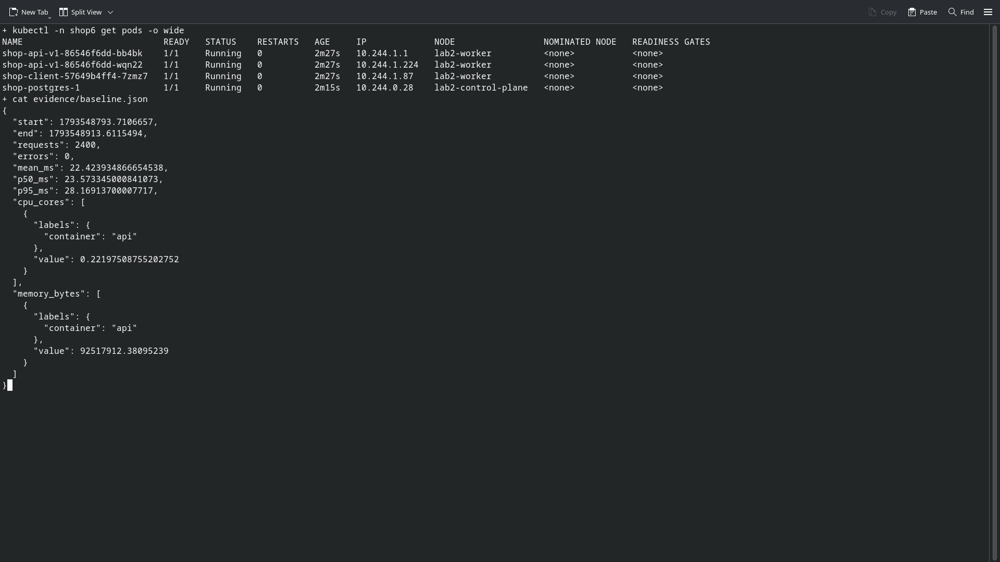
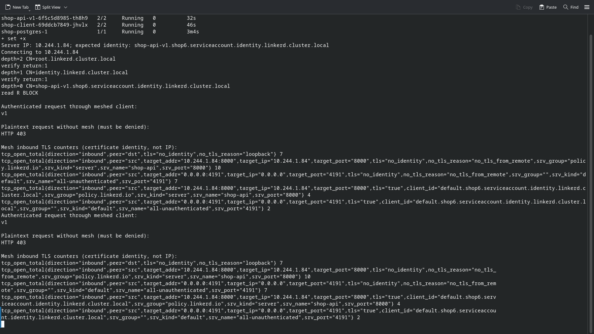

# Лабораторная 6 — Автопилот релиза

## Сервисы и гейт

Продолжил API из третьей лабораторной: добавил `/version`, `FAIL=true` для v2 и `FLAKY=true` для v1. Flaky случайно отклоняет 30% заказов до INSERT; успешные заказы действительно сохраняются в PostgreSQL. `/health` остаётся исправным даже у плохой версии: readiness не должна скрыть проверяемую ошибку бизнес-запроса. Обычные `/order` и `/orders` сохранены.

Гейт читает Prometheus и изменяет веса HTTPRoute. Его код и отдельный Dockerfile находятся в `gate/`, код API — в `services/`. При недоступных или неполных метриках гейт удерживает текущую долю, а не считает отсутствие данных признаком здоровья.

## Выбор mesh

Выбрал Linkerd edge-26.10.2 (Helm charts 2026.10.2). Для этого опыта нужны mTLS, повторы и взвешенный HTTPRoute; отдельный L7 waypoint Istio ambient усложнил бы небольшой стенд. Linkerd ставит Rust proxy рядом с приложением, control plane раздаёт маршруты и сертификаты. Это sidecar mesh: экономию ресурсов ниже проверяю измерением, а не предполагаю по названию продукта.

Установка — [install-mesh.sh](infrastructure/install-mesh.sh), только официальный chart и небольшой values-файл. CA и issuer создаются локально, приватные ключи остаются вне репозитория. Срок issuer — 90 дней: это учебный стенд без автоматической ротации issuer, перед повторением после истечения сертификатов их нужно обновить.

Сохранил Kyverno Enforce: разрешил официальный registry `cr.l5d.io/linkerd`, а namespace `linkerd` добавил к инфраструктурным исключениям. Прикладные Pod по-прежнему должны иметь app label, limits и не использовать privileged/host namespaces. Init-контейнеру mesh нужен root и NET_ADMIN внутри сетевого namespace Pod для iptables; это не privileged и не hostNetwork.

Документация: [Helm installation](https://linkerd.io/2-edge/tasks/install-helm/), [traffic shifting](https://linkerd.io/2-edge/tasks/traffic-shifting/), [retries](https://linkerd.io/2-edge/reference/retries/). Повторы и разделение трафика выполняет исходящий прокси: источник запросов тоже должен быть включён в mesh.

## Baseline без mesh

Чарт `shop` продолжает третью–пятую работы: API и CNPG PostgreSQL. Для независимых экспериментов установил отдельный release в `shop6`, не меняя старый `shop` и его данные. Убрал worker, batch и сетевые опыты; добавил две версии API и клиент нагрузки. API и клиент закреплены на `lab2-worker`. Существующий кластер двухнодовый, PostgreSQL и часть мониторинга находятся на control-plane: вместо отдельного однонодового кластера использовал прежнюю инфраструктуру. Это отклонение от облегчённой схемы задания; размещение БД одинаковое в обоих замерах.

Без mesh работают две реплики v1 и один клиент. Нагрузка — 20 настоящих `POST /order` в секунду в течение 120 секунд, без повторов в клиенте. Сохранил [baseline](evidence/baseline.json): задержка каждого клиентского запроса, CPU и средний working set по cAdvisor за то же окно. Отсчёт ресурсов — сумма обеих реплик API. Запросы идут по Kubernetes Service, не через port-forward; port-forward используется только для чтения Prometheus.

## mTLS и identity

Включил injection через values чарта для API и клиента. У API и клиента теперь по два контейнера, PostgreSQL в mesh не включён (порт 5432 исключён). Защищается участок client → API; соединение API → PostgreSQL в этом опыте остаётся обычным PostgreSQL TCP.

Добавил `Server`, `MeshTLSAuthentication` и `AuthorizationPolicy`: бизнес-порт API разрешён только клиентам с сертификатом identity из `shop6`. Сертификат сервера проверил настоящим OpenSSL TLS handshake на IP Pod: проверка цепочки до локального trust anchor и DNS identity `shop-api-v1.shop6.serviceaccount.identity.linkerd.cluster.local` проходит. Таким образом, подключаюсь к IP, но доверяю имени сервисного аккаунта, подтверждённому подписью CA. Согласован TLS 1.3 с AEAD-шифром; это криптографическое подтверждение шифрования, а не вывод о нём по наличию аннотации.

[Полный вывод проверки](evidence/mtls.txt) содержит публичную цепочку сертификатов, cipher и Verify return code 0. Настоящий запрос meshed client возвращает v1; тот же открытый HTTP с ноды получает 403. Прокси API считает `tls="true"` с `client_id="default.shop6.serviceaccount.identity.linkerd.cluster.local"`: клиент аутентифицирован по сертификату. Приватные ключи в доказательство не входят.

